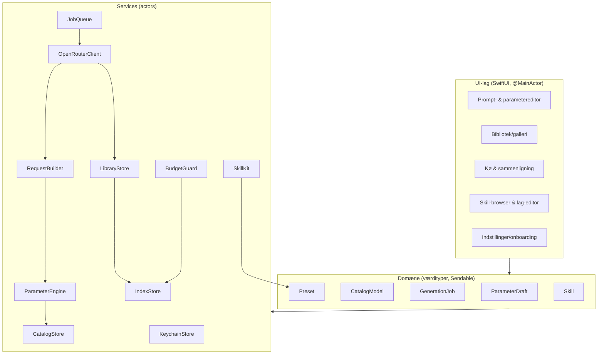
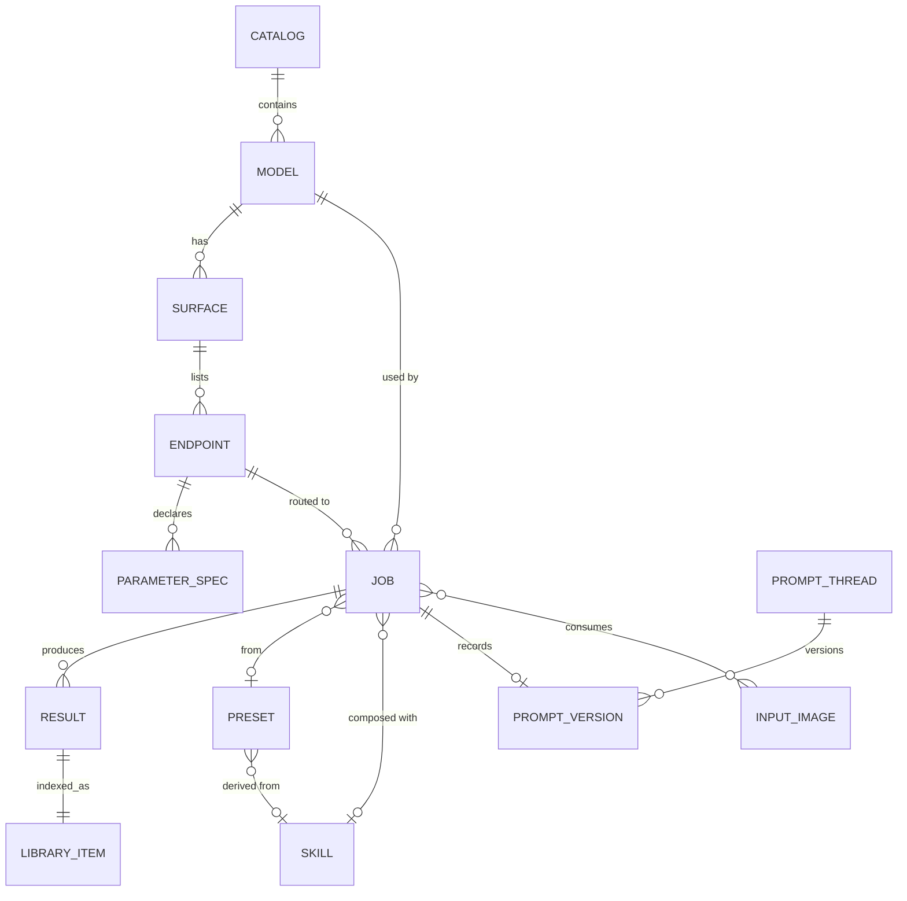
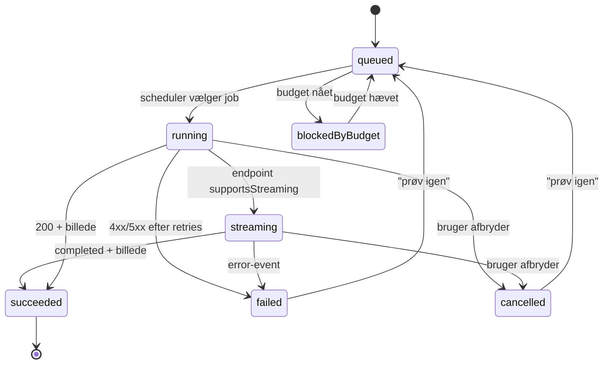
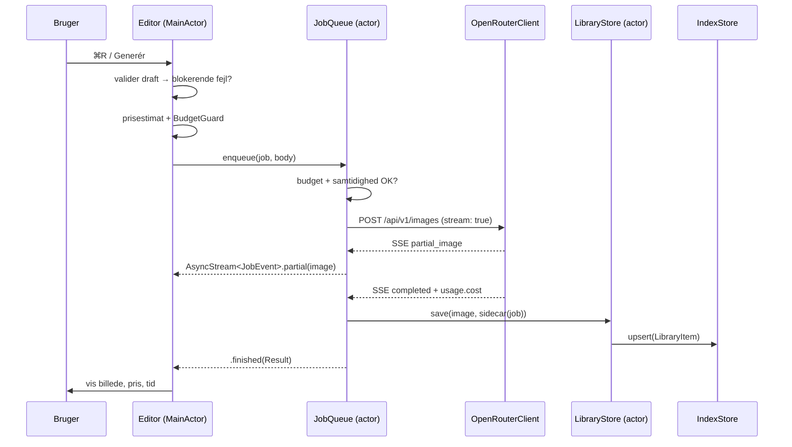

# PRD — Netsi Image

**Produkt:** Netsi Image — en native macOS-billedgenerator til OpenRouter
**Version:** 0.1 (første udkast)
**Dato:** 11. november 2026
**Status:** Til gennemlæsning
**Ejer:** Sten Hougaard
**Kilde til sandhed for modeller og parametre:** `openrouter-image-ui-catalog.json` (schemaVersion 1.0.0, genereret 2026-11-11)

---

## TL;DR

Netsi Image er en SwiftUI-app til macOS, der lader dig generere billeder gennem OpenRouter og **justere samtlige parametre, den valgte model faktisk understøtter** — ikke et håndplukket udvalg. Formularen genereres dynamisk ud fra appens medfølgende modelkatalog (68 modeller, 69 image-endpoints, 1.907 parameter-poster fordelt på 13 kontroltyper), med validering, betinget logik, prisestimat, batch-kø, modelsammenligning og et filbaseret bibliotek hvor hvert billede har sin egen JSON-sidecar. Derudover kan appen **importere og eksportere Agent Skills** (`.skill`-mapper med `SKILL.md`), så genbrugelige opskrifter kan deles på tværs af værktøjer.

Vigtigste princip: **intet felt er hardkodet**. Alt, hvad der vises i formularen, kommer fra katalogets `parameters`-liste for det valgte endpoint. Når kataloget opdateres, får appen nye felter uden kodeændringer.

---

## Indholdsfortegnelse

- [PRD-SEC-001 — Overview & Objectives](#prd-sec-001--overview--objectives)
- [PRD-SEC-002 — Target Audience](#prd-sec-002--target-audience)
- [PRD-SEC-003 — Core Features](#prd-sec-003--core-features)
- [PRD-SEC-004 — Technical Stack Recommendations](#prd-sec-004--technical-stack-recommendations)
- [PRD-SEC-005 — Conceptual Data Model](#prd-sec-005--conceptual-data-model)
- [PRD-SEC-006 — UI Design Principles](#prd-sec-006--ui-design-principles)
- [PRD-SEC-007 — Security Considerations](#prd-sec-007--security-considerations)
- [PRD-SEC-008 — Development Phases](#prd-sec-008--development-phases)
- [PRD-SEC-009 — Challenges & Solutions](#prd-sec-009--challenges--solutions)
- [PRD-SEC-010 — Future Expansions](#prd-sec-010--future-expansions)
- [Bilag A — Katalogfakta](#bilag-a--katalogfakta)
- [Bilag B — Request-mapping og pseudokode](#bilag-b--request-mapping-og-pseudokode)
- [Bilag C — Sidecar- og skill-formater](#bilag-c--sidecar--og-skill-formater)
- [Bilag D — Åbne spørgsmål og beslutningspunkter](#bilag-d--åbne-spørgsmål-og-beslutningspunkter)
- [Changelog](#changelog)

---

## PRD-SEC-001 — Overview & Objectives

### 1.1 Problemet

OpenRouter eksponerer billedmodeller fra 17 providers med vidt forskellige parametre: `aspect_ratio` hos nogle, `size` hos andre, `quality`, `background`, `output_format`, `seed`, Recrafts `user_controls`, Sourcefuls `font_inputs`, routing-felter som `provider.only` og `provider.sort`, og provider-specifikke undermapper som `provider.options.openai.complexity`. OpenRouters egen web-UI dækker kun et fælles minimum, og de officielle API-dokumenter beskriver feltet — ikke hvilke endpoints der reelt accepterer det, og med hvilke grænser.

Resultatet er, at man enten underudnytter modellerne (kører standardindstillinger) eller gætter og får 400-fejl. Samtidig findes der intet godt sted at gemme resultaterne: prompt, model, alle parametre, pris og seed forsvinder, når browserfanen lukkes.

### 1.2 Vision

> **Én app hvor enhver OpenRouter-billedmodel kan køres på sine egne præmisser — med fuld parameterkontrol, fuld sporbarhed og genbrugelige opskrifter.**

Netsi Image skal føles som et værktøj til en professionel, der arbejder seriøst med billedgenerering: hurtigt at komme fra idé til første billede, men uden at nogen parameter er skjult.

### 1.3 Mål (Objectives)

| # | Mål | Måles på |
|---|---|---|
| O-1 | **Fuld parameterdækning** — hvert felt, som det valgte endpoint melder, kan sættes i UI | Automatisk test: antal gengivede felter = antal `parameters` i kataloget for endpointet (100 %) |
| O-2 | **Korrekte requests** — intet sendes, der ikke er dækket af endpointets skema | 100 % af afsendte requests validerer mod katalogets skema + `activeWhen` + `valueConstraints` |
| O-3 | **Sporbarhed** — hvert gemt billede kan genskabes ud fra sin sidecar | 100 % af biblioteksposter har prompt, model, endpoint, alle anvendte parametre og request-body |
| O-4 | **Økonomisk kontrol** — ingen overraskelser på regningen | Prisestimat før kørsel; budgetloft kan blokere kørsel; 0 utilsigtede overskridelser |
| O-5 | **Genbrug** — opskrifter kan gemmes, deles og importeres som skills | Eksport → import i ren installation giver identisk request-body |
| O-6 | **Hastighed i arbejdsgangen** | Fra app-start til synligt genereringsresultat: median ≤ 15 s (ekskl. modeltid), parameter-panel-skift ≤ 150 ms |

### 1.4 Ikke-mål (Non-goals for v1)

- Træning, fine-tuning eller egen modelhosting.
- Redigeringslærred med pensler/lag (kun maske-input til modeller, der understøtter det).
- Flerbrugerkonti, teams, roller eller cloud-synkronisering.
- App Store-distribution (App Sandbox er slået til fra dag 1, men en klient-side nøgle er ikke App Store-kompatibel — se PRD-SEC-007).
- Afvikling af vilkårlig kode fra importerede skills.
- Offentligt prompt-marked eller galleri på nettet.
- Video-generering som selvstændigt workflow (animerede formater som GIF understøttes alene via modellens egne parametre, fx `frame_count`).

### 1.5 Omfang (Scope) for v1

| Område | I v1 | Senere |
|---|---|---|
| Platform | macOS 27+ (Apple Silicon) | iOS/iPadOS (fase 7), Intel-macOS hvis efterspurgt |
| API-flader | Alle tre: `images`, `chatCompletions`, `responses` | — |
| Modeller | Alle i kataloget + live-opdaterede | — |
| Parametre | Alle i kataloget, inkl. routing og provider-options | — |
| Bibliotek | Lokal mappe, filer + JSON-sidecar, SwiftData-indeks | iCloud-synk, smarte samlinger |
| Skills | Import og eksport af `SKILL.md`-mapper | Skill-pakker som zip, deling via URL |
| Nøgle | Direkte kald, Keychain | Proxy-backend ved App Store/iOS |
| Sprog | Dansk UI (katalogets labels er da-DK) | Engelsk |

### 1.6 Succeskriterier for v1.0

1. En bruger kan vælge enhver af de 68 modeller og se alle dens parametre beskrevet med label, type og kilde.
2. En bruger kan generere et billede med standardindstillinger i under 30 sekunder efter første start (ekskl. modeltid).
3. Alle genererede billeder findes som selvstændige filer, der kan åbnes i Finder uden appen — med læsbar metadata.
4. En gemt opskrift kan eksporteres som skill-mappe og importeres igen med identisk resultat.
5. Ingen API-nøgle findes i filer, logs, sidecars eller eksporter.

### 1.7 Ordliste

| Begreb | Betydning |
|---|---|
| **Katalog** | `openrouter-image-ui-catalog.json` — snapshot af modeller, endpoints, parametre, priser og skemaer |
| **Flade (surface)** | OpenRouter-endpointfamilie: `images`, `chatCompletions`, `responses` |
| **Endpoint** | En model hos en bestemt provider, fx `minimax/minimax-h3-image-highspeed@minimax` |
| **ParameterSpec** | Ét felt i kataloget: `key`, `path`, `schema`, `control`, `evidence`, evt. `activeWhen`/`valueConstraints` |
| **Provider-pin** | `providerPin` = `{ only: [slug], allow_fallbacks: false }`, der låser requesten til endpointets provider |
| **Uindstillet (unset)** | Feltet er ikke sat af brugeren og sendes **ikke** med — forskelligt fra at sætte det til providerens default |
| **Sidecar** | JSON-fil ved siden af billedet med al metadata for genereringen |
| **Skill** | Mappe med `SKILL.md` (+ evt. `references/`, `assets/`, `params.json`) i Agent Skills-format |
| **Opskrift (preset)** | Gemt kombination af model, prompt-skabelon, parametre og evt. skill |

---

## PRD-SEC-002 — Target Audience

### 2.1 Primær persona — "Sten, den tekniske skaber"

- Solo-udvikler/designer, arbejder dagligt på macOS, kender API'er og JSON.
- Bruger OpenRouter i forvejen, men irriterer sig over at skulle slå parametre op pr. model.
- Vil kunne se og styre **alt** — også `seed`, `provider.sort`, `trace` og provider-options.
- Har brug for, at billeder og prompts ikke forsvinder, og at de kan findes igen om et halvt år.
- Foretrækker tastaturgenveje og tæt informations­tæthed frem for store ikoner.

**Jobs to be done**
1. "Når jeg har en idé, vil jeg hurtigt se, hvad den valgte model kan, så jeg ikke gætter."
2. "Når et billede bliver godt, vil jeg kunne genskabe og variere det præcist."
3. "Når jeg laver 20 variationer, vil jeg sætte dem i kø og se prisen, før jeg trykker kør."
4. "Når jeg finder en god opskrift, vil jeg gemme og dele den som en fil — ikke som en skærmbillede-agtig note."

### 2.2 Sekundær persona — "Designeren, der ikke koder"

- Kender prompt-skrivning, men ikke `temperature` og `top_p`.
- Har brug for fornuftige standarder, forklarende hjælpetekster og "Vis avanceret"-niveauer.
- Vil have præsentable resultater, sammenligning og eksport til andre værktøjer.

### 2.3 Antagelser om brug

- Enkeltbruger pr. Mac; ingen delte konti.
- Netværk kræves til generering; appen skal fungere offline til at browse katalog, presets og bibliotek.
- Brugeren har egen OpenRouter-konto og accepterer OpenRouters vilkår og providerernes datapolitik.
- Billeder kan være store (op til flere tusinde pixels) og mange (titusinder over tid).

---

## PRD-SEC-003 — Core Features

Prioriteter: **P0** = blokerer v1, **P1** = v1, **P2** = v1 hvis tid, ellers 1.1.

Oversigt:

| ID | Feature | Prioritet | Fase |
|---|---|---|---|
| PRD-FEAT-001 | Modelkatalog med bundlet snapshot og live-opdatering | P0 | 1 |
| PRD-FEAT-002 | Schema-drevet parameterformular (13 kontroltyper) | P0 | 2 |
| PRD-FEAT-003 | Validerings- og betingelsesmotor | P0 | 2 |
| PRD-FEAT-004 | Request-builder for tre API-flader og provider-routing | P0 | 2–3 |
| PRD-FEAT-005 | Generering med live streaming-preview | P0 | 3 |
| PRD-FEAT-006 | Billedbibliotek: filer, sidecars og søgeindeks | P0 | 3 |
| PRD-FEAT-007 | API-nøgle i Keychain og appindstillinger | P0 | 1 |
| PRD-FEAT-008 | Prisestimat og budgetloft | P1 | 4 |
| PRD-FEAT-009 | Prompt-historik med versionsdiff | P1 | 4 |
| PRD-FEAT-010 | Presets, favoritter og parameter-søgning | P1 | 4 |
| PRD-FEAT-011 | Input-billeder: referencer og masker | P1 | 3–4 |
| PRD-FEAT-012 | Batch-kø med persistens og genforsøg | P1 | 4 |
| PRD-FEAT-013 | Sammenlign modeller side om side | P1 | 4 |
| PRD-FEAT-014 | Skills: import og eksport af `SKILL.md`-mapper | P1 | 5 |
| PRD-FEAT-015 | Shortcuts / App Intents | P2 | 6 |
| PRD-FEAT-016 | Eksport, deling og notifikationer | P2 | 6 |

---

### PRD-FEAT-001 — Modelkatalog med bundlet snapshot og live-opdatering

**Formål:** Appen kender alle modeller, endpoints og parametre — også dem, der kom til efter app-builden.

**Beskrivelse**

- `openrouter-image-ui-catalog.json` bundles som ressource i appen og er den primære kilde.
- Kataloget dekodes **lazy** (actor-baseret `CatalogStore`), så app-start ikke venter på 2,4 MB JSON.
- Ved "Opdater katalog" hentes friske data fra de i kataloget angivne `sources` (`/api/v1/images/models`, `/api/v1/images/models/{author}/{slug}/endpoints`, `/api/v1/models?output_modalities=image`, `/openapi.json`) og mappes til **samme** `Catalog`-model. Resultatet caches lokalt med `generatedAt` og kilde-URL pr. sektion.
- Opdateret katalog valideres mod katalogets eget `schemaVersion`; ved skemabrud bevares sidste gyldige katalog, og appen viser en advarsel i stedet for at gå i stykker.
- Brugeren kan se "Katalog fra 11.11.2026 · 68 modeller · 17 providers" i indstillinger og en "Opdater"-knap i modelvælgeren.

**Delopgaver**

- `PRD-FEAT-001.1` — Model af katalog-JSON i Swift (`Codable` + `JSONValue`), tolerant over for ukendte felter.
- `PRD-FEAT-001.2` — `CatalogStore` actor med lazy per-model dekodning og in-memory cache.
- `PRD-FEAT-001.3` — Live-refresh-klient + mapping af OpenRouter-svar til katalogstruktur.
- `PRD-FEAT-001.4` — Validering, versionshåndtering og rollback til sidste gyldige katalog.
- `PRD-FEAT-001.5` — Modelvælger-UI med søgning, publisher-filter, flade- og provider-badge samt "understøtter streaming"-badge.

**Acceptance criteria**

- **AC-1.1** Ved kold start vises modelvælgeren med alle 68 modeller inden for 500 ms på en M-series Mac.
- **AC-1.2** Valg af `openai/gpt-image-2.6-sunburst` viser præcis de 17 parametre, kataloget angiver for dets første endpoint — hverken flere eller færre.
- **AC-1.3** Ved vellykket refresh vises nyt `generatedAt`, og eventuelle nye modeller fremgår af listen; ved HTTP-fejl eller skemabrud forbliver det gamle katalog aktivt, og en fejlbesked vises.
- **AC-1.4** Modelvælgeren kan filtrere på publisher, flade, provider og tekst; filteret er stabilt efter refresh.
- **AC-1.5** Appen fungerer fuldt ud offline med det bundlede katalog (bortset fra selve genereringen).

---

### PRD-FEAT-002 — Schema-drevet parameterformular (13 kontroltyper)

**Formål:** Alle parametre for det valgte endpoint kan justeres i en læsbar, grupperet formular — uden hardkodede felter.

**Beskrivelse**

Formularen bygges udelukkende ud fra `surfaces[surface].endpoints[].parameters`. Katalogets `control`-felt bestemmer widget:

| `control` | Antal poster i kataloget | Widget |
|---|---:|---|
| `select` | 357 | `Picker` (menu) fra `schema.enum` / `capability.values` |
| `text` | 283 | `TextField` |
| `json-editor` | 410 | Tekst-editor med JSON-syntaks, inline-validering og formatering |
| `number` | 232 | `TextField` + `Stepper`/`Slider` med min/max fra skema |
| `multi-select` | 190 | `Menu` med afkrydsning / chips |
| `checkbox` | 142 | `Toggle` |
| `repeater` | 78 | Liste af objekt-rækker med tilføj/fjern og `maxItems`-håndhævelse |
| `ordered-multi-select` | 69 | Liste med træk-og-slip for rækkefølge |
| `textarea` | 69 | `TextEditor` med tegnoptælling |
| `image-list` | 68 | Billedbånd med drag & drop og `maxItems`-tæller |
| `size-input` | 6 | Bredde × højde-felter med validering mod `capability` |
| `image-input` | 2 | Enkelt billedvælger (fx maske) |
| `constant` | 1 | Skrivebeskyttet felt |

Regler:

- **Tri-state værdier.** Hvert felt er enten *uindstillet* (sendes ikke), *sat* af brugeren eller *nulstillet til standard*. UI viser "Standard (sendes ikke)" som placeholder. Dette følger katalogets `ui.defaults`: et upstream-default beskriver providerens API og skal ikke sendes med, medmindre brugeren vælger det.
- **Gruppering.** Felter med `group: "routing"` (345 poster) og `group: "provider_options"` (130 poster) placeres i sammenklappelige sektioner "Routing" og "Provider-options" — adskilt fra modelparametrene. Felter uden gruppe vises først, sorteret: `required` først, derefter katalogorden.
- **Nestede paths.** `path` kan være flere niveauer, fx `["provider","options","sourceful","font_inputs"]`. Et provider-slug med skråstreg (`google-ai-studio/global`) forbliver **én** nøgle i path, ikke to.
- **Forslag uden tvang.** 207 poster har `suggestedValues` (fx typiske aspect ratios eller størrelser). De vises som autocomplete-forslag i `text`/`size-input`-felter, men feltet forbliver frit — forslaget er ikke en grænse.
- **Bevis-badge.** Hvert felt viser et lille badge med `evidence` og et værktøjstip med `source`-link:

  | `evidence` | Badge | Betydning |
  |---|---|---|
  | `endpoint_catalog`, `general_endpoint_catalog` | ● Verificeret | Endpointet melder feltet og grænserne |
  | `openapi` | ○ Skema | Felt i OpenRouters offentlige API-skema |
  | `openrouter_documentation`, `historical_documentation` | ◐ Dok. | Dokumenteret, men måske ikke i endpoint-kataloget |
  | `upstream_schema`, `cross_surface_hint` | ◑ Provider | Herkomst fra provider/anden flade — kan fejle |
  | `surface_unverified`, `allowlist_only`, `inferred_type` | ◇ Usikker | Kun allowlist eller gættet type; advar brugeren |

- **Filter.** "Vis kun verificerede felter" og "Vis kun ændrede felter" er tilgængelige i panel-toolbar.
- **Søgning.** Fritekstsøgning matcher `key`, `label` og `path`, med tastaturnavigation og auto-udvidelse af den sektion, der indeholder træf.

**Delopgaver**

- `PRD-FEAT-002.1` — `ParameterSpec`-dekodning inkl. `schema`, `capability`, `group`, `note`, `allowedBy`.
- `PRD-FEAT-002.2` — Widget-factory for de 13 kontroltyper med fælles `ParameterField`-protokol.
- `PRD-FEAT-002.3` — Tri-state værdimodel (`ParameterValue = unset | value(JSONValue)`).
- `PRD-FEAT-002.4` — Path-baseret formularstate (`ParameterDraft`) med sæt/fjern/læs pr. path.
- `PRD-FEAT-002.5` — Søgning, filtre, sammenklapning og tastaturnavigation.
- `PRD-FEAT-002.6` — Hjælpetekst pr. felt fra `label`, `note` og type (generisk genereret, ikke hardkodet pr. model).

**Acceptance criteria**

- **AC-2.1** For hvert endpoint i kataloget gengives antallet af felter i formularen lig antallet af `parameters` (automatisk snapshot-test pr. model).
- **AC-2.2** Et felt med `control: "select"` viser præcis `schema.enum`-værdierne; et felt uden enum men med `capability.values` viser disse.
- **AC-2.3** `number`-felter håndhæver `minimum`/`maximum` fra skemaet og accepterer ikke tekst.
- **AC-2.4** Et `image-list`-felt med `maxItems: 16` (12 felter i kataloget har netop 16; grænsen varierer 1–20) stopper ved 16 og forklarer hvorfor.
- **AC-2.5** Et uindstillet felt optræder ikke i den genererede request-body (verificeret i JSON-forhåndsvisning).
- **AC-2.6** Skift mellem to modeller bevarer allerede satte værdier, hvis feltet findes på begge endpoints med kompatibel type; ellers markeres de som "ikke understøttet" og fjernes fra requesten efter bekræftelse.
- **AC-2.7** Formularen kan bruges fuldt ud med tastatur og VoiceOver (alle felter har label og værdibeskrivelse).

---

### PRD-FEAT-003 — Validerings- og betingelsesmotor

**Formål:** Så lidt som muligt sendes forgæves, og brugeren forstår hvorfor et felt er utilgængeligt.

**Beskrivelse**

Fire kontroller. De tre første er præcis dem, katalogets `ui.schemaValidation` foreskriver; den fjerde dækker providerspecifikke krav, som skemaet ikke kan udtrykke:

1. **Skemavalidering** af hver værdi, med kataloget som rod for lokale `$ref`. Understøttede nøgler: `type` (inkl. `["string","null"]`), `enum`, `const`, `minimum`, `maximum`, `minLength`, `maxLength`, `pattern`, `minItems`, `maxItems`, `required`, `properties`, `items`, `anyOf`/`oneOf`/`allOf`. Ukendte nøgler ignoreres med en advarsel i debug-log.
2. **`activeWhen`** (16 poster) i tre varianter: `equals` (4 poster, fx `frame_count` kun når `output_format == "gif"`), `in` (10 poster) og `minItems` (2 poster, fx `markup`-masken kræver mindst ét referencebillede). Feltet vises deaktiveret eller skjules, afhængigt af brugerindstilling "Skjul inaktive felter" (standard: skjul med tæller i sektionsheader).
3. **`valueConstraints`** (13 poster, fx `background: "transparent"` kræver `output_format ∈ {png, webp}`): valgmuligheden markeres som utilgængelig med forklaring, og hvis den allerede er valgt, vises en blokerende fejl med et "Ret"-forslag (skift format til png).
4. **`constraints`** (5 poster) beskriver krav til selve indholdet, som skemaet ikke kan udtrykke: `mediaType` (masken skal være PNG), `transparent: true`, `matchDimensionsOfReference` (masken skal have samme dimensioner som referencebillede nr. N) og `pixelSize`. Appen kontrollerer dem lokalt, før afsendelse, og forklarer hvad der skal rettes.

Desuden:

- **Endpoint-grænser vinder over modelgrænser**: hvis modellens OpenAPI-skema tillader et større interval end endpointets `capability`, bruges endpointets.
- **Blokerende vs. advarende fejl**: `required` mangler, forkert type og overtrådt grænse = blokerende. Usikker `evidence` uden konflikt = advarende.
- **Kør-knappen** er deaktiveret med en fejlopsummering ("3 felter mangler opmærksomhed" → klik ruller til første fejl).
- **Felt-forslag**: når en valideringsfejl vedrører et andet felt (fx gennem `valueConstraints`), tilbydes et ét-kliks fix.

**Delopgaver**

- `PRD-FEAT-003.1` — `JSONSchemaValidator` (ren Swift, ingen tredjepart) med `$ref`-opløsning mod `$defs`.
- `PRD-FEAT-003.2` — `ConditionEvaluator` for `activeWhen` (`equals`, `in`, `minItems`, path-opslag; ukendt operator → feltet behandles som aktivt med advarsel).
- `PRD-FEAT-003.3` — `ValueConstraintEvaluator` og `FieldConstraintEvaluator` (`mediaType`, `transparent`, `matchDimensionsOfReference`, `pixelSize`) med menneskelæsbar forklaring pr. regel.
- `PRD-FEAT-003.4` — Fejlmodel: `ValidationIssue { path, severity, message, fixSuggestion }`.
- `PRD-FEAT-003.5` — UI-integration: felt-niveau fejl, sektionsopsummering, global kør-status.

**Acceptance criteria**

- **AC-3.1** En request med `output_format: "jpeg"` og `background: "transparent"` blokeres med beskeden om, at transparent kræver png/webp.
- **AC-3.2** `frame_count` er utilgængeligt, når `output_format` ikke er `gif`, og skjules/disabled i overensstemmelse med brugerindstillingen.
- **AC-3.3** En `$ref` til `ContentPartImage` valideres korrekt som objekt med `type == "image_url"` og `image_url.url`.
- **AC-3.4** `null`-bare typer (`["integer","null"]`) accepterer tom værdi som `null`, men feltet forbliver frivilligt.
- **AC-3.5** Fejl i ét felt forhindrer ikke redigering af andre felter, og fejlen forsvinder, når den rettes.
- **AC-3.6** Validering af en fuld request tager < 20 ms for 200 felter.
- **AC-3.7** En `markup`-maske, der ikke er PNG, ikke har alpha eller har andre dimensioner end `input_references[0]`, afvises før afsendelse med en konkret forklaring pr. overtrådt `constraints`-regel.

---

### PRD-FEAT-004 — Request-builder for tre API-flader og provider-routing

**Formål:** At oversætte formularens tilstand til en request-body, der er korrekt for den valgte flade — og vise den præcist, før den sendes.

**Beskrivelse**

**Flader** (fra katalogets `apiSurfaces`):

| Flade | Metode/path | Body | Resultatudtræk |
|---|---|---|---|
| `images` | `POST /api/v1/images` | `ImageGenerationRequest` | `data[*].b64_json`, `data[*].media_type`, `usage.cost` |
| `chatCompletions` | `POST /api/v1/chat/completions` | `ChatRequest` | `choices[*].message.images[*].image_url.url` |
| `responses` | `POST /api/v1/responses` | `ResponsesRequest` | `output[*].result`, hvor item-type er `image_generation_call` |

Modelvælgeren viser, hvilke flader modellen har (24 modeller har alle tre, 65 har `images`). Fladen er en egenskab ved jobbet og vises som en segmentkontrol øverst i formularen, når modellen har mere end én.

**Mapping** (katalogets `ui.requestMapping`):

- Hvert aktivt felt sættes på sin `path`; hvert pathelement er én nøgle.
- Uindstillede, valgfrie felter udelades.
- `model` sættes altid til `scope.modelId` (endpointets modelversion sendes kun, hvis den findes som parameter).
- Ved **eksplicit providervalg**: endpointets `providerPin` flettes ind i `request.provider` (`{ only: [slug], allow_fallbacks: false }`), og valgte provider-options lægges under `provider.options.<slug>`.
- Ved **automatisk routing**: kun parametre med en fælles kvalificeret route sendes; appen advarer, hvis en valgt parameter ikke er gyldig for alle ruter.
- `stream: true` sættes kun, hvis endpointet har `supportsStreaming` og brugeren har slået streaming til.

**JSON-forhåndsvisning** er altid tilgængelig (⌘⇧J): pretty-printet body, kopierbar, med "vis kun ændrede felter" og en diff mod sidste kørsel. Store base64-inputbilleder vises som `"url": "<fil: navn, 1,2 MB>"` i preview, men sendes fuldt ud.

**Delopgaver**

- `PRD-FEAT-004.1` — `RequestBuilder` pr. flade med fælles `ParameterApplier` til path-sætning.
- `PRD-FEAT-004.2` — `ProviderRoutingPlanner` (eksplicit pin vs. auto).
- `PRD-FEAT-004.3` — `ResponseDecoder` pr. flade inkl. SSE-variant (se FEAT-005).
- `PRD-FEAT-004.4` — JSON-forhåndsvisning med diff og kopiér/eksportér som `.json`/`curl`.
- `PRD-FEAT-004.5` — Flade-segmentkontrol og advarsel ved manglende flade.

**Acceptance criteria**

- **AC-4.1** For `openai/gpt-image-2.6-sunburst` med prompt, `aspect_ratio: "3:2"`, `quality: "high"`, `output_format: "png"` og eksplicit provider `openai` produceres en body, der er identisk med katalogets `requestExamples[0].body` (fraset feltorden).
- **AC-4.2** Ingen request indeholder nøgler, som ikke findes i endpointets `parameters` (bortset fra `model` og `stream`).
- **AC-4.3** Et felt på path `["provider","options","sourceful","font_inputs"]` resulterer i netop den nestede struktur.
- **AC-4.4** Ved skift mellem flader bevares fælles felter (prompt, model, routing), og fladespecifikke felter markeres som "gælder ikke denne flade".
- **AC-4.5** JSON-forhåndsvisningen opdateres < 50 ms efter en feltændring og kan kopieres med ⌘C.
- **AC-4.6** Streaming sættes kun for de 10 endpoints, der melder `supportsStreaming: true`.

---

### PRD-FEAT-005 — Generering med live streaming-preview

**Formål:** Et tryk på "Generér" giver hurtigt synligt resultat, og lange kørsler føles levende.

**Beskrivelse**

- Job indsendes via `OpenRouterClient` (URLSession, async/await) med `Authorization: Bearer <nøgle>` og `HTTP-Referer`/`X-Title` sat til appen (OpenRouters anbefalede identifikation).
- **Streaming** (SSE, `text/event-stream`) håndteres for endpoints med `supportsStreaming`:
  - `image_generation.partial_image` → delbillede vises progressivt i resultatvisningen.
  - `image_generation.completed` → endeligt billede + `usage.cost`.
  - `error` → fejlobjekt vises med request-id.
  - Terminal `[DONE]` afslutter strømmen.
- **Ikke-streaming** viser deterministisk progress med forløbet tid og "typisk 8–45 s for denne model" (baseret på brugerens egne historiske målinger for endpointet, kun hvis ≥ 3 målinger findes; ellers ingen gæt).
- **Afbryd** sender cancellation; allerede modtagne delbilleder bevares i jobbet som "afbrudt".
- **Resultatvisning**: stort billede, metadata-linje (model, provider, tid, pris), knapper: Gem i bibliotek (sker automatisk, se FEAT-006), Variation, Åbn i Preview, Kopiér prompt, Vis request.
- **Fejlhåndtering**: 401 (nøgle), 402 (kredit), 429 (rate limit, vis `retry-after`), 5xx (tilbyd genforsøg), netværksfejl (tilbyd offline-kø). Fejlbody fra OpenRouter vises rå i en "Detaljer"-disclosure.
- **Idempotens**: hvert job har en UUID, der logges i sidecaren, så dobbeltklik ikke giver dobbelt kørsel.

**Delopgaver**

- `PRD-FEAT-005.1` — `OpenRouterClient` med timeout, retry-politik og fejlmapping.
- `PRD-FEAT-005.2` — `SSEParser` (inkrementel, håndterer chunk-grænser midt i events).
- `PRD-FEAT-005.3` — `GenerationCoordinator` (actor) der binder draft → job → resultat.
- `PRD-FEAT-005.4` — Progress- og resultatvisning inkl. delbilleder.
- `PRD-FEAT-005.5` — Fejl-UI med handlingsforslag og request-id.

**Acceptance criteria**

- **AC-5.1** Med en gyldig nøgle og `openai/gpt-image-2` returnerer et job et billede, der gemmes og vises, og `usage.cost` registreres på jobbet.
- **AC-5.2** For et streaming-endpoint vises mindst ét delbillede, før det endelige billede ankommer; delbilledet har korrekt størrelse og kan vises uden at hele strømmen er læst.
- **AC-5.3** SSE-parseren håndterer events delt over flere TCP-chunks og flere events i én chunk (unit-test med syntetiske fragmenter).
- **AC-5.4** Afbrydelse stopper netværkstrafikken inden for 1 s og efterlader jobbet i status `cancelled`.
- **AC-5.5** En 429 viser `retry-after` og tilbyder "Prøv igen om X s".
- **AC-5.6** API-nøglen optræder aldrig i fejlbeskeder, logs eller request-dumps.

---

### PRD-FEAT-006 — Billedbibliotek: filer, sidecars og søgeindeks

**Formål:** Billeder og deres opskrift lever videre uden appen — og kan findes igen.

**Beskrivelse**

**Lagring** (brugeren vælger rodmappe første gang; adgang via security-scoped bookmark):

```
<Netsi Image rod>/
├── Library/
│   └── 2026/11/11/
│       ├── 20261111-142233-gpt-image-2.6-sunburst-a1b2c3.png
│       └── 20261111-142233-gpt-image-2.6-sunburst-a1b2c3.json   ← sidecar
├── Thumbnails/
│   └── <sha256[:2]>/<sha256>_512.heic
├── Presets/
│   └── <preset-slug>.json
├── Skills/
│   └── <skill-slug>/…                                            ← importerede skills
└── library.sqlite                                                ← indeks (SwiftData/GRDB)
```

- **Filnavn**: `yyyyMMdd-HHmmss-<model-slug>-<jobid-6>.ext`. Kollisioner løses med suffix.
- **Sidecar**: JSON v1 (se Bilag C) med prompt, sammensat prompt, model, endpoint, flade, provider, alle **anvendte** parametre, fuld request-body, pris, tid, seed (hvis kendt), dimensioner, hash, skill/preset-referencer og app-version.
- **Metadata i filen**: kompakt JSON indlejres som PNG `iTXt`/JPEG `XMP`/WebP `EXIF`-chunk (≤ 64 KB; ellers kun sidecar). Så er billedet selvbeskrivende, også hvis det flyttes væk fra sidecaren.
- **Indeks**: SwiftData-entitet pr. fil med uddrag af metadata til hurtig søgning (model, prompt-tekst, tags, dato, pris, favorit). Indekset er **afledt** og kan genopbygges ved at scanne mappen ("Genopbyg indeks").
- **Dedupe**: SHA-256 af billedbytes; identisk billede gemmes ikke to gange, men får en ekstra reference.
- **Importere eksterne billeder**: træk en fil ind i appen → den får en "løs" bibliotekspost uden job, med noten "importeret".
- **Sletning**: flyt til macOS Papirkurv (ikke hard delete), både billede og sidecar, med bekræftelse; indeks opdateres.

**Delopgaver**

- `PRD-FEAT-006.1` — `LibraryStore` actor: skrivning atomisk (temp + rename), hash, sidecar-generering.
- `PRD-FEAT-006.2` — `IndexStore` med SwiftData-model og genopbygning fra filsystem.
- `PRD-FEAT-006.3` — Thumbnail-generering (ImageIO, 512 px HEIC) i baggrundskø med begrænset parallelisme.
- `PRD-FEAT-006.4` — Galleri-UI: gitter, filtre (model, dato, favorit, tag), søgefelt, stort preview.
- `PRD-FEAT-006.5` — Metadata-panel med "Vis request", "Kopiér opskrift til editoren", "Åbn i Finder".
- `PRD-FEAT-006.6` — Indlejring af metadata i billedcontainere.

**Acceptance criteria**

- **AC-6.1** Efter en generering findes både billede og `.json` i dagsmappen, og billedet åbner i Preview uden appen.
- **AC-6.2** Sidecaren indeholder alle anvendte parametre og en request-body, der ved gentagelse giver samme request (feltvis lighed).
- **AC-6.3** Sletning af `library.sqlite` og genstart + "Genopbyg indeks" genskaber alle poster fra filerne.
- **AC-6.4** Søgning på et ord fra en prompt finder posten inden for 300 ms ved 10.000 poster.
- **AC-6.5** Et genereret billede, der flyttes manuelt i Finder, vises som "mangler" i indekset og kan relinkes eller fjernes.
- **AC-6.6** Der skrives aldrig uden for den valgte rodmappe.

---

### PRD-FEAT-007 — API-nøgle i Keychain og appindstillinger

**Formål:** Nøglen er nem at sætte op, svær at lække og aldrig i filer.

**Beskrivelse**

- Nøgle indtastes i Indstillinger → Konto, gemmes som generisk password-item i login-Keychain med `kSecAttrAccessibleAfterFirstUnlockThisDeviceOnly` og tilgås via `SecItem*`-API.
- Ved første start vises en onboarding med tre trin: (1) indsæt nøgle, (2) vælg biblioteksmappe, (3) vælg standardmodel.
- "Test nøgle" laver et billigt kald (fx `GET /api/v1/key` eller models-liste) og viser kreditsaldo, hvis API'et tillader det.
- Nøglen kan slettes; appen går i read-only-tilstand (katalog og bibliotek virker stadig).
- Indstillinger i øvrigt: standardflade, standardmodel, biblioteksrod, antal samtidige jobs (1–4), streaming til/fra, skjul inaktive felter, udseende (system/lys/mørk), sprog (dansk i v1), telemetri (fra som standard), "Vis usikre felter".

**Delopgaver**

- `PRD-FEAT-007.1` — `KeychainStore` med læs/skriv/slet og fejlhåndtering (locked keychain, denied).
- `PRD-FEAT-007.2` — Onboarding-flow med validering af nøgle og mappe.
- `PRD-FEAT-007.3` — Settings-model (SwiftData/`@AppStorage` for simple felter) og UI.
- `PRD-FEAT-007.4` — Read-only-tilstand uden nøgle.

**Acceptance criteria**

- **AC-7.1** Nøglen findes i Keychain og ikke i `UserDefaults`, sidecars, logs eller appens container-filer (verificeret med `log stream` og filsøgning).
- **AC-7.2** Ugyldig nøgle giver en forståelig fejl i onboarding og gemmes ikke.
- **AC-7.3** Sletning af nøgle kræver bekræftelse og efterlader appen funktionel til offline brug.
- **AC-7.4** Ved keychain-lås vises en vejledning, og appen crasher ikke.

---

### PRD-FEAT-008 — Prisestimat og budgetloft

**Formål:** Man ved, hvad et klik koster, før man klikker.

**Beskrivelse**

- Estimering tager udgangspunkt i endpointets `pricing`-liste. Kataloget har 10 forskellige `billable`/`unit`-kombinationer:

  | `billable` / `unit` | Eksempel på beregning |
  |---|---|
  | `output_image` / `image` | `cost_usd × n` |
  | `output_image` / `megapixel` | `cost_usd × (w×h/1e6) × n` |
  | `output_image` / `token` | interval: `cost_usd × estimeret tokens` (se nedenfor) |
  | `output_image` / `request` | `cost_usd × antal requests` |
  | `input_text` / `token` | `cost_usd × estimat(prompt-tokens)` |
  | `input_image` / `token` \| `image` \| `megapixel` | ud fra inputbilleder |
  | `input_reference` / `image` \| `request` | ud fra antal referencer |
  | `input_font` / `image` | ud fra fonte |

- Hvor prisen er token-baseret og output ukendt, vises et **interval** ("≈ $0,04–0,11") med tydelig note om usikkerhed, ikke et falsk præcist tal.
- **52 endpoints har ingen prisdata** → vis "Pris ukendt for denne provider" og lad budgetloftet være advarende (ikke blokerende), medmindre brugeren har slået "blokér ukendt pris" til.
- **Budgetloft**: månedligt loft i USD, varsel ved 80 %, hård stop ved 100 %. Forbrug beregnes fra `usage.cost` på alle jobs i indekset (ikke fra estimater), og vises i en lille statuslinje ("$3,18 af $25 denne måned").
- **Før-kørsel-bekræftelse**: kører et job over en brugerdefineret tærskel (fx $0,50), kræves et ekstra klik.

**Delopgaver**

- `PRD-FEAT-008.1` — `CostEstimator` med strategi pr. `billable`/`unit` og usikkerhedsmarkering.
- `PRD-FEAT-008.2` — Token-estimering for prompt (tegn/4-heuristik) med tydelig "estimat"-label.
- `PRD-FEAT-008.3` — `BudgetGuard` actor: forbrugsopsummering pr. måned, varsel, blokering.
- `PRD-FEAT-008.4` — UI: prislinje under prompt, forbrugsindikator, indstillinger for loft og tærskel.

**Acceptance criteria**

- **AC-8.1** For et `output_image/image`-endpoint vises `cost_usd × n` med to decimaler og "$"-valuta.
- **AC-8.2** For et tokentakseret endpoint vises et interval, ikke et enkelt tal.
- **AC-8.3** Når månedsforbruget overstiger loftet, er "Generér" deaktiveret med forklaring og et link til indstillinger.
- **AC-8.4** Faktureret forbrug i indekset stemmer med summen af `usage.cost` fra gennemførte jobs.
- **AC-8.5** Et job, der ikke returnerer `usage.cost`, tælles ikke som $0, men som "ukendt", og kan ikke skjule en overskridelse.

---

### PRD-FEAT-009 — Prompt-historik med versionsdiff

**Formål:** At kunne se, hvad der ændrede sig mellem to kørsler — i tekst og i parametre.

**Beskrivelse**

- Hver kørsel gemmes som `PromptVersion` i en `PromptThread`. En tråd kan være "fri" (startet fra editoren) eller knyttet til et preset/skill.
- **Tekst-diff**: ordniveau, side-om-side, med farvemarkering.
- **Parameter-diff**: tabel med kun ændrede felter: `path · før · efter`, inkl. "tilføjet" og "fjernet".
- **Tilbage til version**: indlæser prompt og parametre i editoren (uden at slette nyere versioner).
- **Forklaring**: brugeren kan skrive en kort note pr. version ("mere varmt lys"), som vises i historiklisten.
- Historikken kan filtreres pr. model og pr. tråd og eksporteres som Markdown.

**Delopgaver**

- `PRD-FEAT-009.1` — `PromptThread`/`PromptVersion`-model og lagring.
- `PRD-FEAT-009.2` — Tekst- og parameter-diff (egen implementering, ingen tung afhængighed).
- `PRD-FEAT-009.3` — Historik-panel med versioner, noter og gendan.
- `PRD-FEAT-009.4` — Markdown-eksport af tråd.

**Acceptance criteria**

- **AC-9.1** To kørsler med forskellig `quality` viser præcis én række i parameter-diffen.
- **AC-9.2** Gendan af en ældre version ændrer ikke eksisterende versioner eller gemte billeder.
- **AC-9.3** Diff-visningen håndterer store prompts (10.000 tegn) uden mærkbar forsinkelse (< 300 ms).

---

### PRD-FEAT-010 — Presets, favoritter og parameter-søgning

**Formål:** Det gode setup skal kunne genbruges med ét klik.

**Beskrivelse**

- **Preset** = navn + valgfri model/flade + parametre + prompt-skabelon + tags + evt. skill-reference. Gemmes som JSON i `Presets/` (læsbart og delbart) og i indekset.
- **Anvend preset**: vælger model (hvis angivet), indlæser parametre som "sat", lader felter, der ikke findes på modellen, stå som "ikke understøttet" i en advarselsboks.
- **Favoritter**: stjernemarkering af presets, prompts, modeller og biblioteksposter.
- **Parameter-søgning** (del af FEAT-002) plus "Vis kun ændrede" og "Føj til favoritter" pr. felt.
- **Import/eksport af preset** som `.json` og via fil-menuen; round-trip uden tab.

**Delopgaver**

- `PRD-FEAT-010.1` — `Preset`-model, filformat og indeks.
- `PRD-FEAT-010.2` — Preset-browser med tags, søgning og forhåndsvisning.
- `PRD-FEAT-010.3` — Anvend/merge-logik med konfliktliste.
- `PRD-FEAT-010.4` — Favoritter på tværs af entiteter.

**Acceptance criteria**

- **AC-10.1** Et preset med 12 parametre genskaber alle 12 som "sat", når modellen understøtter dem.
- **AC-10.2** Et preset til model A kan anvendes på model B; felter, B ikke har, listes i en advarsel og sendes ikke.
- **AC-10.3** Eksport → slet → import giver identisk `Preset`-objekt (feltvis lighed, undtagen id/tidsstempler).

---

### PRD-FEAT-011 — Input-billeder: referencer og masker

**Formål:** Modeller til redigering og reference skal kunne bruges ordentligt.

**Beskrivelse**

- **`image-list`**-felter (`input_references`, 68 poster, typisk `maxItems` 16) får et bånd: drag & drop, filvælger, indsæt fra udklipsholder, træk for at omordne, slet.
- Billeder sendes som `ContentPartImage` (`{ "type": "image_url", "image_url": { "url": … } }`). Appen vælger repræsentation:
  1. `data:`-URL med base64 (standard, virker overalt),
  2. ekstern `https`-URL hvis brugeren angiver en (fx CDN).
- **Størrelseskontrol**: før afsendelse vises samlet payload-størrelse; billeder over 4 MB tilbydes nedskaleret (længste side 2048 px, JPEG 90 %) med et klik, og originalen bevares i sidecarens reference.
- **`image-input`** (2 poster) bruges fx til `markup`/maske: enkel billedvælger med "tegn maske"-hjælp (alpha-kanal eller sort/hvid).
- Inputbilleder kopieres ind i `Library/Inputs/<hash>.<ext>` (eller refereres via bookmark), så opskriften kan gentages, selv hvis originalen flyttes — brugeren vælger adfærd.
- Inputbilleder tæller med i prisestimatet (FEAT-008).

**Delopgaver**

- `PRD-FEAT-011.1` — `ImageAttachment`-model med hash, dimensioner, original-sti og valgt repræsentation.
- `PRD-FEAT-011.2` — Drag & drop/udklipsholder/validering (type, størrelse, maxItems).
- `PRD-FEAT-011.3` — Base64-kodning på baggrundstråd + payload-estimat.
- `PRD-FEAT-011.4` — Nedskalering og maskehjælp.

**Acceptance criteria**

- **AC-11.1** Et felt med `maxItems: 16` accepterer 16 billeder og afviser det 17. med forklaring.
- **AC-11.2** Inputbilleder påvirker ikke UI-tråden: kodning af 4 × 3 MB billeder giver ikke hakkende animation.
- **AC-11.3** Request-body validerer mod `ContentPartImage`-definitionen.
- **AC-11.4** Nedskaleret billede ændrer ikke originalfilen.

---

### PRD-FEAT-012 — Batch-kø med persistens og genforsøg

**Formål:** At kunne sætte mange variationer i gang og lave noget andet imens.

**Beskrivelse**

- Jobkøen er en actor med persistens (SwiftData), så jobs overlever app-genstart.
- **Tilføj til kø** fra editoren med et antal (`n`) eller med en liste af prompt-varianter (én pr. linje eller CSV).
- **Kø-panel**: status pr. job (venter, kører, færdig, fejlet, afbrudt), progress, pris, "flyt op", "afbryd", "prøv igen".
- **Samtidighed** 1–4 (standard 2), konfigurerbar pr. flade. Rate limit-håndtering: ved 429 pauses køen globalt i `retry-after` sekunder.
- **Genforsøg**: automatisk op til 2 gange ved 429/5xx/netværksfejl med eksponentiel backoff; aldrig automatisk ved 4xx-fejl, der kræver brugerhandling (401/402/400).
- **Budget**: køen stopper, når budgetloftet nås; resterende jobs markeres "blokeret af budget".
- **Notifikation** ved kø-fuldførelse (se FEAT-016).

**Delopgaver**

- `PRD-FEAT-012.1` — `JobQueue` actor med persistens og genoptagelse.
- `PRD-FEAT-012.2` — Scheduler med samtidighedsgrænse og global rate-limit-pause.
- `PRD-FEAT-012.3` — Retry-politik pr. fejltype.
- `PRD-FEAT-012.4` — Kø-UI med sortering og batch-handlinger.
- `PRD-FEAT-012.5` — Prompt-variantliste (linje/CSV-import).

**Acceptance criteria**

- **AC-12.1** 10 jobs i kø med samtidighed 2 kører 2 ad gangen og alle 10 færdiggøres.
- **AC-12.2** Genstart af appen midt i en kørsel genoptager køen; kørende jobs markeres "afbrudt" og kan genstartes.
- **AC-12.3** En 429 fra ét job pauser hele køen i den angivne tid og genoptager derefter automatisk.
- **AC-12.4** En 400-fejl genforsøges ikke automatisk, og fejlårsagen vises på jobbet.
- **AC-12.5** Køen stopper ved budgetloft, og ingen yderligere request sendes.

---

### PRD-FEAT-013 — Sammenlign modeller side om side

**Formål:** At vælge model på baggrund af resultat og pris, ikke på fornemmelse.

**Beskrivelse**

- Vælg 2–4 modeller (fra samme flade) og kør **samme prompt og samme fælles parametre**.
- Appen beregner fællesnævnet: felter, som alle valgte modeller har med kompatibel type, sendes; modellernes egne felter vises som "kun denne model" og kan sættes pr. kolonne.
- Resultater vises i et gitter med model, pris (faktisk), tid, dimensioner. "Behold" markerer favorit; "Anvend opskrift" kopierer en kolonnes parametre til editoren.
- Sammenligningen gemmes som en `CompareRun` med alle deljobs, så den kan genåbnes.

**Delopgaver**

- `PRD-FEAT-013.1` — `ComparePlanner` der finder fælles parametre.
- `PRD-FEAT-013.2` — Kørsel via køen med fælles prompt.
- `PRD-FEAT-013.3` — Gitter-UI med metriklinje og handlinger.

**Acceptance criteria**

- **AC-13.1** En sammenligning med 3 modeller sender 3 requests, alle med identisk prompt og identiske fælles parametre (verificeret i request-body).
- **AC-13.2** Parametre, der ikke er fælles, sendes ikke til modeller, der ikke understøtter dem.
- **AC-13.3** Pris pr. kolonne er den faktisk returnerede `usage.cost`, ikke estimatet.

---

### PRD-FEAT-014 — Skills: import og eksport af `SKILL.md`-mapper

**Formål:** At kunne genbruge og dele opskrifter i Agent Skills-format — ind og ud.

**Beskrivelse**

**Import**

- Importér en mappe (eller `.zip`) der indeholder `SKILL.md` med YAML-frontmatter (`name`, `description`, evt. `license`, `metadata`).
- Appen læser `SKILL.md` som **data**: `description` → vises i skill-browseren; instruktionsteksten → indgår som prompt-lag; `references/` og `assets/` → vises som vedhæftede resurser, der kan lægges i prompt-kompositionen eller bruges som inputbilleder.
- Understøttet udvidelse: `params.json` (valgfri) med model, flade og parameter-preset, samt `prompt-template.md` med pladsholdere (`{{prompt}}`, `{{subject}}`, `{{style}}`).
- Import kopieres ind i `Skills/<slug>/` med `origin.json` (kildesti/URL, importdato, SHA-256 af `SKILL.md`). Brugeren kan se, at indholdet kommer fra tredjepart.
- **Ingen scripts køres.** Filer med eksekveringsbit eller `.sh`/`.py` importeres som tekst og vises som "ikke afvikles". Stier saniteres (ingen `..`, ingen absolutte stier, ingen symlinks ud af roden).

**Prompt-komposition (lag)**

Editoren viser en lag-model med fast, synlig rækkefølge:

```
1. Skill-instruktioner   (fra SKILL.md / prompt-template, valgfrit lag)
2. Stil-preset           (evt. preset-prompt)
3. Bruger-prompt         ({{prompt}})
4. Negative/supplerende  (evt. negativt lag, hvis modellen har et felt til det)
```

- Hvert lag kan slås til/fra og omordnes (1↔2). Den **sammensatte prompt** vises i sin helhed og kan kopieres; en diff mod brugerens rå prompt gør det tydeligt, hvad skill'en tilføjer.
- Lagene sendes som én `prompt`-streng til flader uden rollemodel; til `chatCompletions` kan skill-laget sendes som `system`-besked (valgfrit, med advarsel om, at det er mere "instruerende").

**Eksport**

- Fra et preset eller en tråd: "Eksportér som skill" genererer

```
<navn-slug>/
├── SKILL.md            (frontmatter: name, description, license, metadata.netsi-image)
├── prompt-template.md  (brugerens prompt-skabelon med pladsholdere)
├── params.json         (model, flade, parametre)
├── references/         (valgfrit: noter)
├── assets/             (valgfrit: eksempelbilleder, kun hvis brugeren vælger det)
└── PROVENANCE.md       (app-version, dato, katalog-version, priser)
```

- Eksport valideres: `SKILL.md` skal have gyldig frontmatter, `name` skal matche mappens slug, og intet må indeholde nøgler eller personlige data (der scannes for `sk-or-`-lignende mønstre).

**Delopgaver**

- `PRD-FEAT-014.1` — `SkillParser` (YAML-frontmatter + Markdown) og `Skill`-model.
- `PRD-FEAT-014.2` — Sikker import: sanitering, kopiering, hash, `origin.json`, størrelsesgrænse.
- `PRD-FEAT-014.3` — Skill-browser med beskrivelse, resurser og "brug i editor".
- `PRD-FEAT-014.4` — Prompt-komposition med lag, forhåndsvisning og diff.
- `PRD-FEAT-014.5` — Skill-eksport med skabeloner og validering.
- `PRD-FEAT-014.6` — Skanner for hemmeligheder/personlige data i eksport.

**Acceptance criteria**

- **AC-14.1** Import af en mappe med gyldig `SKILL.md` viser navn og beskrivelse og kan anvendes i editoren inden for 1 s.
- **AC-14.2** En `SKILL.md` med `../`-stier eller absolutte stier importeres ikke, og brugeren får en konkret fejl.
- **AC-14.3** Den sammensatte prompt indeholder skill-laget kun, når laget er slået til, og rækkefølgen følger lag-listen.
- **AC-14.4** Eksport → import i en ren installation giver identisk prompt-skabelon og identiske parametre.
- **AC-14.5** Eksport nægter at skrive filer, hvis `SKILL.md` mangler `name` eller `description`.
- **AC-14.6** Importerede scripts eksekveres aldrig (verificeret: ingen proces startes ved import eller brug).

---

### PRD-FEAT-015 — Shortcuts / App Intents

**Formål:** At kunne køre faste opskrifter fra Shortcuts, menulinjen eller andre apps.

**Beskrivelse**

- `GenerateImageIntent`: parametre `prompt`, `modelId` (valgfri), `presetId` (valgfri), `skillId` (valgfri), `outputFolder` (valgfri), returnerer `IntentFile` med billedet + metadata.
- `GetLastGenerationsIntent`: returnerer de seneste N resultater.
- `OpenLibraryIntent`: åbner biblioteket filtreret på model/tag.
- Intents kræver nøgle og respekterer budgetloft; ved blokering returneres en tydelig fejl.
- Handlinger optræder i Shortcuts-appen og i menuen "Tjenester".

**Delopgaver**

- `PRD-FEAT-015.1` — `AppIntent`-definitioner med `AppEntity` for model og preset.
- `PRD-FEAT-015.2` — Deling af `GenerationCoordinator` med hovedappen (ingen separat kodevej).
- `PRD-FEAT-015.3` — Fejl- og autorisationshåndtering i intents.

**Acceptance criteria**

- **AC-15.1** En Shortcut med `GenerateImageIntent` gemmer et billede i den angivne mappe og returnerer filen.
- **AC-15.2** Intenten bruger samme validering og budgetregler som UI'et.
- **AC-15.3** Uden nøgle fejler intenten med en handlingsanvisende besked.

---

### PRD-FEAT-016 — Eksport, deling og notifikationer

**Formål:** At få resultaterne ud af appen og vide, hvornår de er klar.

**Beskrivelse**

- **Eksport**: valgte biblioteksposter → mappe, med valgfri `.json`, `.md` (opskrift som læsbar tekst) og CSV-metadata for hele udvalget.
- **Kopiér til udklipsholder** som billede (PNG/TIFF) eller som prompt+parametre.
- **Del**: macOS share sheet (Mail, Messages, AirDrop).
- **Notifikation** (UserNotifications) når et langt job eller en hel kø er færdig, kun hvis appen ikke er i forgrunden; kan slås fra.
- **Markdown-opskrift**: model, endpoint, prompt, tabel over ikke-standard-parametre, pris, seed — klar til at klistre i noter.

**Delopgaver**

- `PRD-FEAT-016.1` — Eksport-service med formater og navngivning.
- `PRD-FEAT-016.2` — Share sheet og udklipsholder.
- `PRD-FEAT-016.3` — Notifikationer med autorisation og respekt for fokus-tilstand.

**Acceptance criteria**

- **AC-16.1** Eksport af 5 poster giver 5 billedfiler + 5 sidecars + 1 CSV i målmappen.
- **AC-16.2** Markdown-opskriften kan læses af et menneske uden appen og indeholder alle ændrede parametre.
- **AC-16.3** Ingen notifikation vises, når appen er i forgrunden.

---

### 3.x Featuroversigt for sprintplanlægning

```mermaid
flowchart LR
    subgraph F1["Fase 1 · Fundament"]
        A1[FEAT-001 Katalog]
        A2[FEAT-007 Nøgle/indstillinger]
    end
    subgraph F2["Fase 2 · Parametermotor"]
        B1[FEAT-002 Formular]
        B2[FEAT-003 Validering]
        B3[FEAT-004 Request-builder]
    end
    subgraph F3["Fase 3 · Generering"]
        C1[FEAT-005 Streaming]
        C2[FEAT-006 Bibliotek]
        C3[FEAT-011 Input-billeder]
    end
    subgraph F4["Fase 4 · Arbejdsgang"]
        D1[FEAT-008 Pris/budget]
        D2[FEAT-009 Historik]
        D3[FEAT-010 Presets]
        D4[FEAT-012 Kø]
        D5[FEAT-013 Sammenlign]
    end
    subgraph F5["Fase 5 · Skills"]
        E1[FEAT-014 Skill import/eksport]
    end
    subgraph F6["Fase 6 · Hærdning"]
        G1[FEAT-015 Shortcuts]
        G2[FEAT-016 Eksport/deling]
    end
    F1 --> F2 --> F3 --> F4 --> F5 --> F6
```



---

## PRD-SEC-004 — Technical Stack Recommendations

### 4.1 Platform og værktøjskæde

| Komponent | Valg | Begrundelse |
|---|---|---|
| Sprog | **Swift 6.4+** | Strikte samtidighedskrav giver sikker baggrundsbehandling af store JSON- og billeddata |
| UI | **SwiftUI** (macOS 27-target) | Native look, `NavigationSplitView`, `Inspector`, `Table`, `Grid`; `@Observable` til state |
| Samtidighed | **Swift Concurrency** (`actor`, `TaskGroup`, `AsyncStream`) | Katalog, kø og bibliotek er naturlige aktører; SSE som `AsyncStream` |
| Netværk | **URLSession** async/await + `URLSession.bytes(for:)` | Ingen tredjepart nødvendig for SSE |
| Billedbehandling | **ImageIO**, **CoreGraphics**, **QuickLookThumbnailing** | Effektiv dekodning, nedskalering og thumbnails uden at loade fulde bitmaps |
| Indeks | **SwiftData** (beslutningspunkt D-1: evt. GRDB/SQLite) | Deklarativt og integreret; hvis søgeydelse på 10.000+ poster ikke er god nok, skiftes til GRDB |
| Nøgle | **Security.framework** (`SecItem*`) | Keychain, ingen egen kryptering |
| Notifikationer | **UserNotifications** | Native |
| Automatisering | **App Intents** | Shortcuts-integration uden AppleScript |
| Test | **Swift Testing** + snapshot-tests af formular pr. model | Parametermotor kræver regressionssikring |
| Katalog | Bundlet JSON i Resources, dekodet lazy | 2,4 MB; må ikke forsinke start |

### 4.2 Arkitektur



**Lagregler**

1. UI må aldrig kende til HTTP eller filsystem — kun til domænetyper og service-protokoller.
2. Katalog er **uforanderligt** efter load; ændringer sker ved at erstatte hele snapshotet atomisk.
3. Job er den eneste bærer af "hvad blev sendt"; alt andet (preset, skill, draft) er input til et job.
4. Alle services er actors eller `Sendable` structs; ingen delt mutable state.

### 4.3 Modulopdeling (Swift Package-struktur)

```
NetsiImage/
├── App/                 # App-entry, menuer, vinduer, kommandoer
├── CatalogCore/         # Katalogmodeller, dekodning, live-refresh
├── ParameterEngine/     # Formularstate, validering, betingelser, kontrolmapping
├── RequestKit/          # Request-builder pr. flade, SSE-parser, response-dekodning
├── JobKit/              # Jobmodel, kø, retry, budget
├── LibraryKit/          # Filer, sidecars, indeks, thumbnails
├── SkillKit/            # SKILL.md-parsing, import/eksport, prompt-komposition
├── DesignSystem/        # Farver, typografi, badges, komponenter
├── Resources/           # openrouter-image-ui-catalog.json, lokalisation (da)
└── Tests/               # Swift Testing: enhed + snapshot pr. model
```

### 4.4 Vigtige tekniske valg og begrundelser

- **Ingen hardkodede parametre.** Hvis et felt skal vises, skal det findes i `parameters`. Det gør appen modstandsdygtig over for, at kataloget opdateres.
- **Tri-state værdier** frem for defaults. Katalogets egen regel: udelad valgfrie felter, medmindre brugeren har sat dem. En `null`/`unset`-sentinel i `ParameterDraft` er nødvendig for at undgå at sende providerens default og dermed ændre adfærd utilsigtet.
- **Egen JSON Schema-validator (begrænset delmængde).** Katalogets skemaer bruger `$ref`, `anyOf`, nullable type-arrays og `const`; en lille, testet validator er nemmere at kontrollere end en tung afhængighed, og kræver ingen netværksadgang. (Alternativ: etableret Swift-pakke — beslutningspunkt D-2.)
- **Snapshot-tests pr. model.** For hver af de 68 modeller genereres formularens feltliste og request-body; testen fejler, hvis antallet af felter afviger fra kataloget. Det er den eneste realistiske måde at holde 1.907 parameter-poster korrekte.
- **Atomisk skrivning i biblioteket** (skriv til temp, `rename`) og hash-baseret dedupe, så en crash midt i en generering ikke efterlader halve filer.
- **Metadata både i sidecar og i filen.** Sidecar er autoritativ; indlejret metadata er en fallback, hvis filen flyttes alene.
- **Ingen telemetri som standard.** Priser og fejl logges lokalt i en rotationsfil uden nøgle og uden prompt-indhold (kan slås til for debugging).

### 4.5 Ydeevnekrav

| Krav | Grænse |
|---|---|
| Kold start til interaktiv modelvælger | ≤ 500 ms |
| Dekodning af ét models-endpoints | ≤ 50 ms |
| Formular-gengivelse ved modelskift | ≤ 150 ms |
| Validering af fuld request | ≤ 20 ms |
| Billedvisning af 12 MP-resultat | ≤ 200 ms (med thumbnail først) |
| Indekssøgning ved 10.000 poster | ≤ 300 ms |
| Hukommelse under batch af 4 samtidige jobs | ≤ 1,5 GB |

---

## PRD-SEC-005 — Conceptual Data Model

### 5.1 Entiteter

| Entitet | Nøgle | Felter (type) | Noter |
|---|---|---|---|
| `Catalog` | `version` | `schemaVersion: String`, `generatedAt: Date`, `baseURL: URL`, `language: String`, `coverage: Coverage`, `models: [ModelRef]` | Uforanderligt snapshot |
| `ModelRef` | `id: String` | `name`, `publisher`, `version`, `versionSource`, `kind`, `inputModalities: [String]`, `outputModalities: [String]`, `catalogDate: Date`, `surfaces: [SurfaceKind: Surface]` | `id` = OpenRouter model-id |
| `Surface` | (`modelId`, `kind`) | `status: String`, `source: URL`, `endpoints: [Endpoint]` | `status` kan være `unverified` |
| `Endpoint` | `id: String` | `providerName`, `providerSlug`, `providerTag`, `modelVersion`, `providerPin: ProviderPin?`, `supportsStreaming: Bool`, `pricing: [PriceRule]`, `parameters: [ParameterSpec]` | `id` = `model@provider` |
| `ParameterSpec` | (`endpointId`, `path`) | `key`, `label`, `path: [String]`, `scope: Scope`, `schema: JSONSchemaNode`, `control: ControlKind`, `required: Bool`, `evidence: EvidenceKind`, `source: URL`, `capability: Capability?`, `activeWhen: Condition?`, `valueConstraints: [ValueConstraint]`, `constraints: FieldConstraints?`, `suggestedValues: [JSONValue]?`, `group: GroupKind`, `note: String?`, `allowedBy: URL?` | Path er unik nøgle inden for endpoint |
| `Job` | `id: UUID` | `createdAt`, `startedAt?`, `finishedAt?`, `modelId`, `endpointId?`, `surface: SurfaceKind`, `prompt: String`, `composedPrompt: String`, `params: [PathKey: JSONValue]`, `requestBody: Data`, `inputImageIDs: [UUID]`, `status: JobStatus`, `attempts: Int`, `costUSD: Decimal?`, `latencyMS: Int?`, `error: JobError?`, `presetID?`, `skillID?`, `promptVersionID?`, `resultIDs: [UUID]` | `requestBody` er den præcise afsendte JSON |
| `JobStatus` | enum | `queued, running, streaming, succeeded, failed, cancelled, blockedByBudget` | Se state machine 5.4 |
| `Result` | `id: UUID` | `jobID`, `index: Int`, `filePath: String`, `sidecarPath: String`, `mediaType: String`, `width: Int?`, `height: Int?`, `sha256: String`, `bytes: Int`, `seed: Int?`, `providerSlug: String?` | En fil pr. resultat |
| `InputImage` | `id: UUID` | `originPath: String`, `storedPath: String?`, `sha256`, `width`, `height`, `bytes`, `mime`, `representation: enum(base64, url)` | Kopieres eller refereres |
| `PromptThread` | `id: UUID` | `title`, `modelId`, `createdAt`, `updatedAt` | Fri eller knyttet til preset |
| `PromptVersion` | `id: UUID` | `threadID`, `parentID?`, `text`, `paramsSnapshot: [PathKey: JSONValue]`, `note?`, `jobIDs: [UUID]`, `createdAt` | Diff-grundlag |
| `Preset` | `id: UUID` | `name`, `slug`, `modelId?`, `surface?`, `params`, `promptTemplate`, `tags: [String]`, `favorite: Bool`, `createdAt`, `updatedAt`, `sourceSkillID?` | Fil i `Presets/` |
| `Skill` | `id: UUID` | `slug`, `name`, `description`, `license?`, `author?`, `rootPath`, `sourceHash`, `importedFrom`, `importedAt`, `promptTemplate?`, `paramOverrides?`, `assets: [String]`, `trust: enum(bundled, imported, exported)` | Aldrig eksekverbar |
| `LibraryItem` | `sha256` | `filePath`, `sidecarPath`, `createdAt`, `modelId?`, `promptText?`, `tags: [String]`, `favorite: Bool`, `width`, `height`, `costUSD?`, `missing: Bool` | Afledt indeks |
| `Budget` | singleton | `monthLimitUSD`, `warnAtPercent`, `hardStop`, `blockUnknownPrice`, `confirmAboveUSD` | Forbrug beregnes fra jobs |
| `AppSettings` | singleton | `libraryRootBookmark: Data`, `defaultModelID?`, `defaultSurface`, `concurrency: Int`, `streamingEnabled`, `hideInactive`, `showUnverified`, `appearance`, `language`, `telemetryEnabled` | |

### 5.2 Relationer



### 5.3 Nøgledetaljer

- **`PathKey`** er en wrapper om `[String]` med strukturel lighed (`provider`, `options`, `sourceful`, `font_inputs` ≠ `provider/options/sourceful/font_inputs` som én nøgle). Serialiseres som JSON-pointer-lignende streng i indekset for søgning.
- **`JSONValue`** er en `Sendable` enum (`null`, `bool`, `number(Decimal)`, `string`, `array([JSONValue])`, `object([String: JSONValue])`). Bruges til både skemaværdier og request-body, så der ikke opstår tab ved round-trip.
- **`Decimal` til priser** (ikke `Double`) for at undgå afrundingsfejl i budgetoptælling.
- **Sidecar er autoritativ**, indeks er cache. `library.sqlite` må slettes uden datatab.

### 5.4 Job-state machine



---

## PRD-SEC-006 — UI Design Principles

### 6.1 Overordnet layout (tre paneler)

```
┌──────────────────────────────────────────────────────────────────────────────┐
│  Netsi Image            [Model: OpenAI GPT Image 2.6 Sunburst ▾]  ⌘R  ⌘,     │
├───────────────┬──────────────────────────────────┬───────────────────────────┤
│  VENSTRE      │  MIDTE                           │  HØJRE                    │
│  (280–360 px) │  (fleksibel)                     │  (320–460 px)             │
│               │                                  │                           │
│  Prompt       │  ┌────────────────────────────┐  │  PARAMETRE   [🔍 søg]     │
│  ┌─────────┐  │  │                            │  │  ─────────────────────    │
│  │ lag:    │  │  │        RESULTAT            │  │  Prompt            ● Ver. │
│  │ skill   │  │  │    (delbillede → endeligt) │  │  ┌─────────────────────┐  │
│  │ preset  │  │  │                            │  │  │ tekstfelt …         │  │
│  │ bruger  │  │  └────────────────────────────┘  │  └─────────────────────┘  │
│  └─────────┘  │  model · provider · 12,4 s · $0,08│  Format      ○ Skema      │
│  Presets ▸    │  [ Variation ][ Gem ][ Vis request]│  (png/jpeg/webp)  ▾      │
│  Historik ▸   │                                  │  Størrelse   ◐ Dok.       │
│  Kø (3) ▸     │  ┌──── Bibliotek ─────────────┐  │  ┌────────────┬─────────┐ │
│  Skills ▸     │  │ [t][t][t][t][t][t][t][t]   │  │  │ 1024 × 1024│  [slider]│ │
│               │  └────────────────────────────┘  │  └────────────┴─────────┘ │
│  Budget:      │                                  │  ▸ Routing (4 felter)     │
│  $3,18 / $25  │                                  │  ▸ Provider-options (2)   │
├───────────────┴──────────────────────────────────┴───────────────────────────┤
│  ✓ Klar · 17 felter · pris ≈ $0,04–0,11     [ Forhåndsvis JSON ⌘⇧J ]  [Generér]│
└──────────────────────────────────────────────────────────────────────────────┘
```

- **Venstre**: prompt-komposition, presets, historik, kø og skills — alt der handler om "hvad".
- **Midte**: resultat og bibliotek — "hvad blev det".
- **Højre**: parameter-inspektør — "hvordan".
- **Bundlinje**: valideringsstatus, prisestimat, JSON-forhåndsvisning og primær handling. Den er altid synlig, så "Generér" aldrig gemmer sig.

Panelbredder kan trækkes og huskes pr. vindue. Begge sidepaneler kan skjules (⌘⌥1 / ⌘⌥2), så midten bliver et stort lærred.

### 6.2 Designprincipper

1. **Alt synligt, intet skjult.** Avancerede felter er sammenklappet, ikke fjernet. Tælleren i sektionsheaderen ("Routing · 4 felter · 1 ændret") gør det tydeligt, at der findes mere.
2. **Ærlighed om usikkerhed.** Bevis-badge og tydelig "estimat"-markering frem for falsk præcision — både for parametre og priser.
3. **Ingen uigenkaldelige handlinger uden fortrydelse.** Sletning går til Papirkurv; model-skift med tabte felter kræver bekræftelse med liste over, hvad der mistes.
4. **Progressive disclosure, ikke skjulte features.** Tre niveauer: (a) `required` + typiske felter, (b) alle modelparametre, (c) routing og provider-options.
5. **Tastatur først.** ⌘R generér, ⌘⇧J JSON, ⌘F søg i felter, ⌘K kommando-palette (model, preset, skill, bibliotek), ⌥↑/⌥↓ flyt mellem felter med fejl.
6. **Rolig æstetik.** Neutral baggrund, ét accentfarve-system, billederne er farven. Ingen dekorativ gradient-støj.
7. **Forklaring i kontekst.** Hjælpetekst pr. felt genereres fra label, type og grænser — ikke fra en håndskrevet modelordbog, der forældes.

### 6.3 Tilgængelighed

- Fuldt tastaturbetjent; fokusring altid synlig.
- VoiceOver-labels genereres fra `label` + type + nuværende værdi ("Baggrund, valgmulighed, transparent").
- Kontrast ≥ 4,5:1 for tekst; bevis-badges har både farve **og** form/tekst (ikke farve alene).
- Reduce Motion respekteres (delbillede-animation erstattes af diskret opdatering).
- Dynamisk tekststørrelse (begrænset i tætte tabeller, men alle labels skalerer).

### 6.4 Tomme tilstande

| Skærm | Tom tilstand |
|---|---|
| Bibliotek | "Ingen billeder endnu. Skriv en prompt og tryk ⌘R." + knap til at vælge eksempelpreset |
| Kø | "Køen er tom." |
| Skills | "Ingen skills importeret." + "Importér mappe…" og et eksempel på `SKILL.md` |
| Historik | "Historikken begynder ved din første kørsel." |

---

## PRD-SEC-007 — Security Considerations

### 7.1 Trusselsmodel

| Trussel | Konsekvens | Modforanstaltning |
|---|---|---|
| API-nøgle lækkes fra klienten | Økonomisk misbrug | Kun Keychain; aldrig i logs, sidecars, eksporter; skanner i skill-eksport; nøglen vises maskeret og kan kun kopieres via Keychain |
| Nøgle i crash-rapport / `log stream` | Læk | Ingen logging af headers; `os.Logger` med `privacy: .private` for alt netværksrelateret |
| Ondsindet skill-mappe (path traversal, symlink, kæmpe fil) | Skrivning uden for bibliotek, diskfyldning | Sanitering af stier, forbud mod `..` og absolutte stier, ingen symlink-følgning, størrelsesgrænse (25 MB/mappe, 200 filer), kopiering ind i egen mappe |
| Prompt injection via skill eller importeret reference | Uventet modeladfærd/omkostning | Skill-indhold er **data**; appen eksekverer intet; lag-forhåndsvisning viser præcis, hvad der sendes; ingen værktøjer gives til billedmodellerne |
| Kodeafvikling via scripts i skills | Fuld kompromittering | Scripts importeres som tekst, vises som "afvikles ikke"; ingen `Process`-kald i SkillKit |
| Uautoriseret filadgang | Læk af private filer | App Sandbox + security-scoped bookmarks; kun adgang til brugerens valgte rodmappe og eksplicit valgte inputfiler |
| Uautoriseret netværksadgang | Dataeksfiltrering | Sandbox-network-entitlement; kun `openrouter.ai` i ATS-allowlist; ingen tredjeparts-SDK'er |
| Prischok / utilsigtet batch | Stor regning | Budgetloft, bekræftelsestærskel, kø-stop, estimat før kørsel |
| Personfølsomme data i prompt/billeder | GDPR-brud | Alt er lokalt; ingen telemetri som standard; sidecar kan slås fra; eksport advarer, hvis prompt indeholder e-mail/telefon-mønstre |

### 7.2 Nøglehåndtering (detaljer)

- Keychain-item: `service = "dk.netsi.image.openrouter"`, `account = "api-key"`, `kSecClassGenericPassword`, `kSecAttrAccessibleAfterFirstUnlockThisDeviceOnly` (kan ikke migreres til anden enhed via backup).
- Læsning sker ved behov og caches kun i hukommelsen i en `actor` med kort levetid; aldrig i `UserDefaults`, `@AppStorage`, filer eller miljøvariabler.
- Nøglen vises aldrig i UI efter indtastning (kun "•••• abcd" med sidste 4 tegn, hentet ved indtastning).
- Rotation: "Skift nøgle" overskriver item og tester den gamle vs. nye ved at kalde et billigt endpoint.

### 7.3 Dataflyt og tredjeparter

- Kun ét eksternt domæne: `openrouter.ai` (og de `sources`-URL'er, kataloget angiver, til refresh).
- Data, der forlader maskinen: prompt, valgte parametre, inputbilleder — til OpenRouter og deres underleverandører (provider-slug fremgår af hvert endpoint). Appen viser provider-navnet tydeligt, før man kører, og en note i Indstillinger om, at providerens datapolitik gælder.
- Ingen analytics, ingen crash-upload, ingen "anonyme statistikker" som standard.

### 7.4 Billed- og indholdshensyn

- Modeller kan generere stødende indhold; appen videresender providerens fejl/afvisning og viser ikke-fjernede resultater som de er, men tilbyder "skjul i bibliotek".
- Ingen aldersverifikation nødvendig for lokal enkeltbrugerapp, men en note i onboarding om ansvar ved deling.

### 7.5 Sandbox og filsystem

- Sandbox aktiveret fra dag 1 (gør senere App Store/Notarization lettere).
- Rodmappe via `NSOpenPanel` → `bookmarkData(options: .withSecurityScope)` gemt i Indstillinger.
- Al skrivning går gennem `LibraryStore`, der først verificerer, at den endelige sti ligger under roden (realpath-sammenligning), før der skrives.
- Ingen udførelse af `.app`/`chmod`-ændringer ved import.

---

## PRD-SEC-008 — Development Phases

Forudsat en udvikler (dig) på deltid; varigheder er vejledende.

| Fase | Indhold | Features | Estimat | Milestone (Definition of Done) |
|---|---|---|---|---|
| **0. Forberedelse** | Repo, Xcode-projekt, Swift Package-moduler, CI (GitHub Actions: build + test), katalog bundlet, `Codable`-model af hele JSON'en med round-trip-test | — | 3–4 dage | `swift test` grøn; katalog dekodes og re-encodes uden tab |
| **1. Fundament** | Katalog-store, modelvælger, onboarding, Keychain, indstillinger, app-skelet med tre paneler | 001, 007 | 1,5 uge | Kan vælge model og se dens endpoint-liste; nøgle gemmes og testes |
| **2. Parametermotor** | Alle 13 kontroller, tri-state, validering, `activeWhen`/`valueConstraints`, request-builder for `images`, JSON-preview, snapshot-tests | 002, 003, 004 (images) | 2,5 uger | Enhver model kan konfigureres og en gyldig `images`-body genereres og valideres |
| **3. Generering & bibliotek** | OpenRouter-klient, SSE, resultatvisning, filer + sidecars, indeks, thumbnails, galleri, inputbilleder | 005, 006, 011 | 2,5 uger | Et billede kan genereres, gemmes, findes igen og genskabes fra sidecar |
| **4. Arbejdsgang** | Pris/budget, historik/diff, presets, kø, sammenligning, fladerne `chatCompletions` og `responses` | 004 (øvrige flader), 008, 009, 010, 012, 013 | 3 uger | Alle tre flader virker; 20 jobs kan køre i kø inden for budget |
| **5. Skills** | SKILL.md-parser, sikker import, lag-komposition, eksport, skanner | 014 | 1,5 uge | Import → brug → eksport → import round-trip på en ren maskine |
| **6. Hærdning & v1.0** | Shortcuts, eksport/deling, notifikationer, tilgængelighed, ydeevne, fejltekster, dokumentation, signering/notarisering | 015, 016 | 1,5 uge | v1.0 bygget, notariseret, testet på ren brugerkonto |
| **7. iOS/iPadOS (senere)** | Adaptivt layout, filadgang via Files, evt. proxy-backend | — | 3–4 uger | — |

**Samlet v1.0: ca. 13–14 uger.**

### 8.1 Sprintplan (2-uges sprints)

| Sprint | Leverance |
|---|---|
| S1 | Fase 0 + start på 1: projekt, katalog-dekodning, app-skelet |
| S2 | Fase 1 færdig: modelvælger, Keychain, onboarding, tre-panels layout |
| S3 | Kontrol-factory (select/text/number/checkbox), tri-state, grundlæggende formular |
| S4 | Resten af kontrollerne, `activeWhen`, `valueConstraints`, JSON-editor, snapshot-tests |
| S5 | Request-builder `images`, JSON-preview, første rigtige generering, fejlhåndtering |
| S6 | Streaming, resultatvisning, bibliotek (filer + sidecar), indeks |
| S7 | Galleri, søgning, thumbnails, inputbilleder, relink/genopbygning |
| S8 | Pris/budget, historik/diff |
| S9 | Presets, kø med persistens |
| S10 | Sammenligning, `chatCompletions` + `responses`-flader |
| S11 | Skills: import, komposition, eksport |
| S12 | Hærdning, Shortcuts, eksport/deling, tilgængelighed, release |

### 8.2 Definition of Done (pr. feature)

- Alle acceptance criteria har en automatiseret test eller en dokumenteret manuel testprocedure.
- Snapshot-test for alle berørte modeller er opdateret og grøn.
- Fejltekster gennemgået på dansk; ingen rå JSON-fejl i hovedflowet.
- VoiceOver-gennemgang af de berørte skærme.
- Ingen nye advarsler i Xcode-build.
- Sidecar-format bagudkompatibelt (nye felter er additive).

---

## PRD-SEC-009 — Challenges & Solutions

| # | Udfordring | Risiko | Løsning |
|---|---|---|---|
| C-1 | **1.907 parameter-poster med heterogene skemaer** (`$ref`, `anyOf`, nullable type-arrays, 13 kontroltyper) | Høj — fejl i én widget rammer mange modeller | Snapshot-test pr. model; kontrol-factory med fælles protokol; ukendt `control` → fallback til `json-editor` med advarsel, aldrig crash |
| C-2 | **Beviskvalitet varierer** (10 endpoints uden pris, 8 `surface_unverified`, 2 `allowlist_only`, 6 `inferred_type`) | Middel — brugeren tror, et felt virker | Badge + filter "kun verificerede"; advarsel før afsendelse af usikre felter; fejlbody vises rå |
| C-3 | **Request-body må ikke sendes med provider-defaults** | Middel — utilsigtet adfærdsændring | Tri-state (`unset`) og "valgfrie felter udelades" som fast regel; test der verificerer fravær af nøgler |
| C-4 | **Endpoint-pin vs. auto-routing** | Middel — parameter sendes til en rute, der ikke accepterer den | Eksplicit provider → `providerPin` flettes ind; auto → kun fælles kvalificerede parametre + tydelig advarsel |
| C-5 | **Nestede paths med slugs indeholdende skråstreg** (`google-ai-studio/global`) | Lav, men lumsk | `PathKey` som `[String]` med strukturel lighed; unit-test med `provider.options.<slug>` |
| C-6 | **Prisestimering ved token-takst uden kendt output** | Middel — falsk præcision | Interval + "estimat"-label; faktisk pris fra `usage.cost` overskriver altid |
| C-7 | **52 endpoints uden prisdata** | Lav — budget kan ikke håndhæves | "Pris ukendt"; valgfri blokering; forbrug registreres som ukendt, ikke 0 |
| C-8 | **Store billeder/base64 i hukommelsen** (batch × 4) | Middel — hukommelsesspids | Streaming/base64 i `TaskGroup`, nedskalering, thumbnail-først, frigiv bitmaps efter skrivning |
| C-9 | **SSE-parsing på tværs af TCP-chunks** | Middel — tabte delbilleder | Inkrementel parser med buffer og tests af fragmenterede events |
| C-10 | **Kataloget ændrer sig** (nye felter, nye modeller, prisændringer) | Middel — appen bliver forældet | Live-refresh + versionsvalidering + rollback; intet hardkodet |
| C-11 | **SwiftData-ydelse ved mange poster** | Middel | Beslutningspunkt D-1: 10.000-post-benchmark i S7; fallback GRDB |
| C-12 | **App Sandbox + valgfri biblioteksmappe** | Lav–middel | Security-scoped bookmarks, sti-validering før skrivning, tydelig fejl ved manglende adgang |
| C-13 | **Skill-formatets variation** (frontmatter, manglende felter, store assets) | Middel | Tolerant parser med advarsler, krævede felter (name, description), størrelsesgrænser |
| C-14 | **Prompt-lag giver uforudsigelig prompt** | Middel — brugeren ved ikke hvad der sendes | Altid synlig sammensat prompt + diff mod rå prompt; lag kan slås fra |
| C-15 | **Test af netværksflow uden at brænde penge** | Middel | Mock-`URLProtocol` med optagede svar og SSE-fragmenter; rigtige kald kun i manuel test |
| C-16 | **Notarisering/signering med sandbox og netværk** | Lav | Hardened Runtime + entitlements tidligt i CI; test på ren konto i S12 |

---

## PRD-SEC-010 — Future Expansions

1. **iOS/iPadOS** — adaptivt layout (parameter-inspektor som sheet), Files-integration, evt. Apple Pencil-maske.
2. **Backend-proxy** — nøgle på server, åbner for App Store-distribution og deling med andre brugere; `ImageProvider`-abstraktion forberedes i v1.
3. **iCloud-synk af bibliotek og presets** — filbaseret (iCloud Drive) først, derefter evt. CloudKit for indeks.
4. **Skill-pakker som `.zip`/URL** — import fra GitHub-repo direkte, med versionskontrol og opdatering.
5. **Skill-afvikling med sandkasse (valgfrit)** — hvis et reelt behov opstår: separate helper-proces med begrænsede rettigheder, eksplicit godkendelse pr. script.
6. **Billedredigering i appen** — beskæring, maske-pensel, op- og nedskalering, baggrundsfjernelse.
7. **Batch fra CSV/JSON-manifest** — "kør denne tabel af prompts × modeller".
8. **Smart samlinger** — regler ("alle billeder med seed, billigere end $0,05, fra Nano Banana").
9. **Prompt-bibliotek med variabler** — `{{subject}}`, `{{style}}` udfyldes i et lille skema.
10. **Sammenlign over tid** — samme prompt, samme model, flere uger: viser modeldrift.
11. **Video/animerede formater** — udvidelse af resultatvisning og bibliotek til mp4/webm, hvis OpenRouter-fladerne tilbyder det.
12. **Team-deling** — read-only deling af presets og skills via fil, uden konti.
13. **Menu bar quick-generate** — lille prompt-felt i menulinjen.
14. **Engelsk UI** — lokaliseringsfiler forberedes i v1 (alle strenge via `LocalizedStringKey`).

---

## Bilag A — Katalogfakta

Målt direkte på `openrouter-image-ui-catalog.json` (2026-11-11):

| Mål | Værdi |
|---|---|
| schemaVersion | 1.0.0 |
| Modeller i alt | 68 |
| Modeller med `images`-flade | 65 (undantag fx `meta/muse-image`) |
| Modeller med `chatCompletions` | 24 |
| Modeller med `responses` | 24 |
| Image-endpoints | 69 |
| Chat-endpoints | 26 |
| Responses-endpoints | 26 |
| Unikke providers (`providerSlug`) | 17 (alibaba, azure, black-forest-labs, google-ai-studio, google-vertex, krea, minimax, openai, recraft, seed, sourceful, tencent, xai m.fl.) |
| Publishere | 14 |
| Parametre i alt | 1.907 (`images` 1.154 · `chatCompletions` 408 · `responses` 345) |
| Endpoints med `supportsStreaming` | 10 |
| Parametre med `activeWhen` | 16 |
| Parametre med `valueConstraints` | 13 |
| Routing-felter (`group: routing`) | 345 |
| Provider-options (`group: provider_options`) | 130 |

**Kontroltyper:** `json-editor` 410 · `select` 357 · `text` 283 · `number` 232 · `multi-select` 190 · `checkbox` 142 · `repeater` 78 · `ordered-multi-select` 69 · `textarea` 69 · `image-list` 68 · `size-input` 6 · `image-input` 2 · `constant` 1.

**Bevisniveauer:** `openapi` 1.158 · `endpoint_catalog` 326 · `general_endpoint_catalog` 120 · `upstream_schema` 117 · `cross_surface_hint` 87 · `surface_unverified` 57 · `historical_documentation` 26 · `openrouter_documentation` 8 · `inferred_type` 6 · `allowlist_only` 2.

**Prisenheder:** `output_image/image` 67 · `output_image/token` 29 · `input_image/token` 21 · `input_text/token` 13 · `input_image/image` 11 · `output_image/megapixel` 4 · `input_reference/request` 4 · `input_reference/image` 2 · `input_font/image` 2 · `output_image/request` 1. **52 endpoints har ingen prisdata.**

**Skematyper:** `string` 653 · `$ref` 299 · `["array","null"]` 207 · `array` 198 · `integer` 119 · `anyOf` 81 · `boolean` 69 · `["boolean","null"]` 72 · `["integer","null"]` 40 · `["number","null"]` 58 · `object` 17 · `number` 12 · `["string","null"]` 11 · `allOf` 2 · ingen type 69.

**Felter på `ParameterSpec` (ud over de altid tilstedeværende `key`, `label`, `path`, `scope`, `schema`, `control`, `required`, `evidence`, `source`):** `group` 475 · `allowedBy` 130 · `capability` 316 · `suggestedValues` 207 · `note` 173 · `activeWhen` 16 · `valueConstraints` 13 · `constraints` 5.

---

## Bilag B — Request-mapping og pseudokode

Katalogets `ui.requestMapping`: *"Sæt hvert aktivt felts værdi på den angivne path. Hvert element i path er én nøgle. Et provider-slug med skråstreg forbliver én nøgle. Udelad valgfrie, uindstillede felter."*

```swift
// ParameterEngine/RequestBuilder.swift (forenklet)

struct PathKey: Hashable, Sendable, Codable {
    let components: [String]          // fx ["provider","options","sourceful","font_inputs"]
}

enum ParameterValue: Sendable, Codable {
    case unset
    case value(JSONValue)
}

func buildBody(
    draft: ParameterDraft,
    endpoint: Endpoint,
    surface: SurfaceKind,
    explicitProvider: Bool,
    streamEnabled: Bool
) throws -> Data {
    var body: [String: JSONValue] = [:]
    let issues = ParameterEngine.validate(draft: draft, endpoint: endpoint)

    // 1. Blokerende fejl stopper afsendelse
    guard !issues.contains(where: { $0.severity == .blocking }) else {
        throw BuildError.validation(issues.filter { $0.severity == .blocking })
    }

    // 2. Sæt hvert aktivt felt
    for spec in endpoint.parameters where isActive(spec, in: draft) {
        guard case .value(let v) = draft[spec.path] ?? .unset else { continue }
        setValue(v, at: spec.path, in: &body)      // opretter nestede objekter
    }

    // 3. Model er altid sat
    body["model"] = .string(endpoint.modelID)

    // 4. Provider-pin flettes ind ved eksplicit valg
    if explicitProvider, let pin = endpoint.providerPin {
        var provider = body["provider"]?.object ?? [:]
        provider["only"] = .array(pin.only.map(JSONValue.string))
        provider["allow_fallbacks"] = .bool(pin.allowFallbacks)
        mergeProviderOptions(from: draft, into: &provider, slug: endpoint.providerSlug)
        body["provider"] = .object(provider)
    } else {
        // Automatisk routing: kun fælles kvalificerede parametre
        warnIfParameterNotCommonToAllRoutes(draft, endpoint)
    }

    // 5. Streaming kun hvor endpointet melder støtte
    if streamEnabled && endpoint.supportsStreaming {
        body["stream"] = .bool(true)
    }

    // 6. Fladespecifik indpakning
    return try encode(surface.envelope(body))
}

func setValue(_ v: JSONValue, at path: [String], in obj: inout [String: JSONValue]) {
    guard let head = path.first else { return }
    if path.count == 1 { obj[head] = v; return }
    var child = obj[head]?.object ?? [:]
    setValue(v, at: Array(path.dropFirst()), in: &child)
    obj[head] = .object(child)
}
```

**Betingelsesevaluering**

```swift
func isActive(_ spec: ParameterSpec, in draft: ParameterDraft) -> Bool {
    guard let when = spec.activeWhen else { return true }
    guard case .value(let current)? = draft[when.path] else { return false }
    if let eq = when.equals, current != eq { return false }
    if let list = when.in, !list.contains(current) { return false }
    return true
}

func violates(_ constraint: ValueConstraint, with value: JSONValue, in draft: ParameterDraft) -> String? {
    guard value == constraint.value else { return nil }
    guard case .value(let other)? = draft[constraint.requires.path] else {
        return "“\(constraint.value)” kræver, at \(constraint.requires.path.joined(separator: ".")) er sat."
    }
    guard constraint.requires.allowed.contains(other) else {
        let allowed = constraint.requires.allowed.map(\.display).joined(separator: " eller ")
        return "“\(constraint.value)” kræver \(constraint.requires.path.joined(separator: ".")) = \(allowed)."
    }
    return nil
}
```

**Genereringsflow**



---

## Bilag C — Sidecar- og skill-formater

### C.1 Sidecar (`*.json`, format v1)

```json
{
  "formatVersion": 1,
  "jobId": "4f9c2a1e-0b4a-4f0f-9b5b-1a2b3c4d5e6f",
  "createdAt": "2026-11-11T14:22:33Z",
  "app": { "name": "Netsi Image", "version": "1.0.0", "build": "1" },
  "catalog": { "schemaVersion": "1.0.0", "generatedAt": "2026-11-11T10:48:18Z" },
  "model": {
    "id": "openai/gpt-image-2.6-sunburst",
    "name": "OpenAI: GPT Image 2.6 Sunburst",
    "endpointId": "openai/gpt-image-2.6-sunburst@openai",
    "provider": "openai",
    "surface": "images"
  },
  "prompt": {
    "raw": "Et fyrtårn ved den jyske vestkyst",
    "composed": "Et fyrtårn ved den jyske vestkyst",
    "layers": [{ "kind": "user", "enabled": true }]
  },
  "parameters": {
    "aspect_ratio": "3:2",
    "quality": "high",
    "output_format": "png",
    "provider.only": ["openai"],
    "provider.allow_fallbacks": false,
    "provider.options.openai.complexity": "high"
  },
  "request": {
    "surface": "images",
    "body": { "model": "openai/gpt-image-2.6-sunburst", "prompt": "…", "aspect_ratio": "3:2" }
  },
  "result": {
    "file": "20261111-142233-gpt-image-2.6-sunburst-a1b2c3.png",
    "sha256": "9f2c…",
    "bytes": 2418822,
    "mediaType": "image/png",
    "width": 1536,
    "height": 1024,
    "seed": 1234567
  },
  "usage": { "costUSD": 0.08, "latencyMS": 12410 },
  "refs": { "presetId": null, "skillId": null, "threadId": "b1e2…" }
}
```

Regler: nye felter er additive; ukendte felter bevares ved genlæsning; `parameters` er de faktisk **anvendte** felter, med `PathKey`-notation (`provider.options.openai.complexity`) for læsbarhed — den præcise struktur findes i `request.body`.

### C.2 Skill-mappe (Agent Skills-format + Netsi-udvidelse)

```markdown
<!-- SKILL.md -->
---
name: dream-palace-pen
description: Delikat penne-tegning med ornamentik og flade lyse farver til eventyrlige scener.
license: CC-BY-4.0
metadata:
  netsi-image: "1"
  model: recraft/recraft-v4-styles-pro
---

# Dream Palace Pen

Brug denne stil når en scene skal føles som en ornamenteret eventyrtegning.

## Instruktioner
- Tydelige, fine pennekonturer
- Flade, lyse trykfarver
- Theatralsk perspektiv og rytmisk ornamentik

## Prompt-skabelon
{{prompt}}. Stil: ornamenteret penne-tegning, flade lyse farver, eventyrligt perspektiv.
```

`params.json` (valgfri Netsi Image-udvidelse):

```json
{
  "formatVersion": 1,
  "model": "recraft/recraft-v4-styles-pro",
  "surface": "images",
  "parameters": {
    "style": "digital_illustration",
    "output_format": "png",
    "n": 1
  },
  "promptTemplate": "{{prompt}}. Stil: ornamenteret penne-tegning, flade lyse farver, eventyrligt perspektiv."
}
```

```
<skill-slug>/
├── SKILL.md
├── params.json           ← valgfri
├── prompt-template.md    ← valgfri (overstyrer skabelon i SKILL.md)
├── origin.json           ← ved import: kilde, dato, hash, trust
├── references/           ← valgfri noter
└── assets/               ← valgfri eksempelbilleder
```

---

## Bilag D — Åbne spørgsmål og beslutningspunkter

| # | Spørgsmål | Påvirker | Anbefaling |
|---|---|---|---|
| D-1 | SwiftData eller GRDB til indeks? | FEAT-006, ydeevne | Mål i S7 med 10.000 poster; skift til GRDB, hvis søgning > 300 ms |
| D-2 | Egen JSON Schema-validator eller Swift-pakke? | FEAT-003 | Egen, begrænset delmængde; pakke kun hvis skemaerne viser behov for mere |
| D-3 | Skal sidecars være slået til som standard? | FEAT-006, privatliv | Ja — det er hele pointen med sporbarhed; kan slås fra |
| D-4 | Skal indlejret metadata i billeder være standard? | FEAT-006 | Ja for PNG (iTXt), valgfrit for JPEG |
| D-5 | Skal "usikre" felter (`allowlist_only`, `inferred_type`) vises som standard? | FEAT-002 | Skjules bag "Vis usikre felter" |
| D-6 | Skal inputbilleder kopieres ind i biblioteket eller refereres? | FEAT-011 | Spørg ved første brug pr. mappe; standard = kopiér |
| D-7 | Skal skills kunne sendes som `system`-besked på chat-fladen? | FEAT-014 | Ja, men fravalgt som standard med forklaring |
| D-8 | Skal `n > 1` køre som ét job med flere resultater eller som n jobs? | FEAT-005/012 | Ét job (matcher API'ets `n`) med flere resultater |
| D-9 | Skal appen kunne bruges uden valgt biblioteksmappe (midlertidigt lager)? | FEAT-006/007 | Nej — onboarding kræver mappe, ellers intet at gemme i |
| D-10 | Skal priser vises i DKK eller USD? | FEAT-008 | USD (OpenRouters valuta), med valgfri DKK-omregning via fast kurs i indstillinger |
| D-11 | Skal `trace`, `session_id` og `user` vises i den almindelige formular? | FEAT-002 | Under "Avanceret" — de er sjældent relevante, men skal kunne sættes |
| D-12 | Skal appen understøtte `openrouter/auto`-routerne (3 stk.)? | FEAT-001/004 | Ja, men med advarsel: parametre kan ikke garanteres på auto-routing |

---

## Changelog

| Version | Dato | Ændring |
|---|---|---|
| 0.1 | 2026-11-11 | Første udkast. Alle ti sektioner, 16 features med acceptance criteria, datamodel, sikkerhed, faser og bilag. Baseret på `openrouter-image-ui-catalog.json` (schemaVersion 1.0.0) og dialog om platform (macOS først), nøglehåndtering (Keychain), biblioteksformat (filer + sidecar + indeks), API-flader (alle tre), UI (dansk, tre paneler) og skills (import + eksport). |
